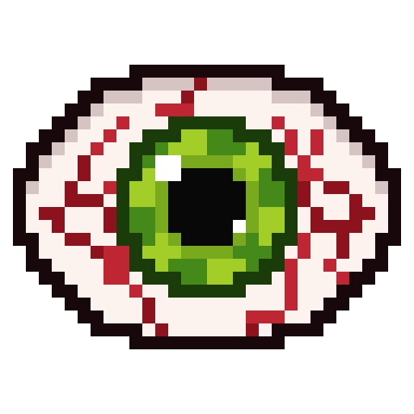
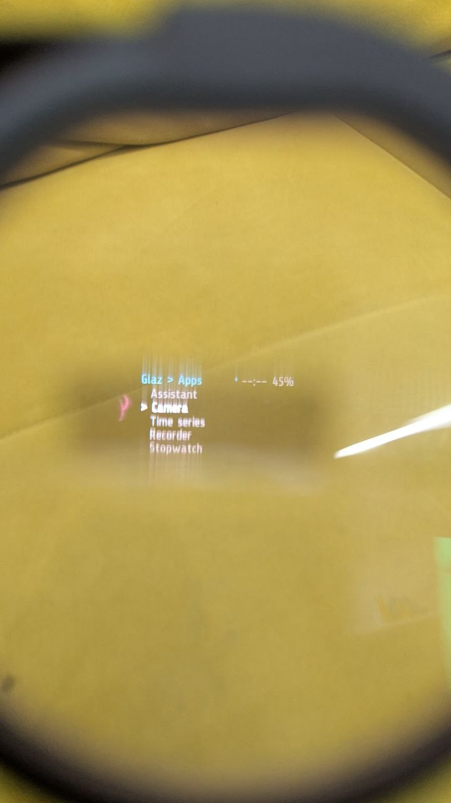

<p align="center">
  
</p>

# glaz

An unofficial app for the
[Brilliant Labs Frame](https://brilliant.xyz/products/frame) smart glasses,
with a companion app for your phone. It is not made or endorsed by Brilliant
Labs.

<!-- Photo: the Frame glasses -->
<!--  -->

**What glaz adds to Frame:** a menu of apps on the glasses that you control
by tapping them and tilting your head, so there are no buttons to press.
On the phone, glaz stores your photos and recordings, sends your
notifications to the glasses, and lets apps on the glasses use the internet.

<!-- Screenshot: the menu on the glasses -->
<!--  -->

## Features

### On the glasses

You control everything with gestures, so you never need to take the phone
out:

| Gesture | What it does |
| --- | --- |
| Tilt your head to a shoulder and back | Scroll the menu up or down |
| One tap | Select, or bring back the last app you used |
| Two taps | Go back; wake the glasses up from sleep |
| Three taps | Go to sleep, from anywhere |

The menu has these apps:

- **Apps**
  - **Assistant**: ask a question out loud and read the answer on the
    glasses. The answer is also read aloud, but only through headphones.
  - **Photo**: take a photo. It is saved on the phone.
  - **Time series**: take a photo every 1 to 60 seconds. It keeps going
    in the background.
  - **Recorder**: a voice recorder. It keeps recording in the background,
    and the phone writes a transcript.
  - **Stopwatch**: keeps counting in the background.
  - **Files**: browse and preview the files stored on the glasses.
  - **Weather**: the weather where you are, from wttr.in.
- **Sensors**: battery level, a live readout of your head angle, and
  **Tap tune** for adjusting how sensitive tap detection is.
- **Settings**: display brightness, and Sleep (put the glasses to sleep now).
- **Info**: your recent phone notifications, Bluetooth status, uptime,
  firmware version, and About.

Apps marked "background" keep running when you leave them, and an icon in
the top bar shows this. New phone notifications pop up on the glasses as
they arrive.

### On the phone

The companion app, `flutter-glaz`, runs on Android and on the Linux desktop.
iOS and macOS builds are in the code but need Xcode.

- **Connect** to the glasses. See the battery level and firmware version.
- **Upload** the glasses app with one tap, choosing which apps go in the
  menu.
- **Update the firmware** over Bluetooth: official releases or the
  extended firmware (see below).
- **Photos and recordings**, sorted by date, with transcripts of the
  recordings.
- **Assistant**: works with any server that speaks the OpenAI chat API.
  The assistant can open apps on the glasses for you.
- **Remote**: control the glasses from the phone screen.
- **Services** the phone does for the glasses: setting the clock,
  sending notifications, internet access and location.
- **Per-app settings**: photo quality, the place for Weather, which apps
  may use the internet, and the Assistant's language.
- **Glasses files** and a **Log** for when something goes wrong.

<!-- Screenshots: the phone app -->
<!--
<p>
  
  
  
</p>
-->

## Extended firmware

glaz runs on the official Frame firmware, but some features need the
**extended firmware** built from the
[`glaz` branch of antono/frame-codebase](https://github.com/antono/frame-codebase/tree/glaz):

- **Two taps to wake.** On the official firmware one tap wakes the glasses,
  so a bag or a table can wake them by accident.
- **Reliable waking.** The glasses always wake on a tap after sleep, no
  matter what the app on them did before it went to sleep.
- **Tap tune.** You can adjust tap sensitivity live, from the glasses. On
  the official firmware this app only shows a message.
- **Free space** on the glasses can be read by apps (`frame.file.space()`).

Builds of the extended firmware have `-glaz` at the end of their version,
for example `v26.291.1045-glaz`. You can install them from the phone app
(**Glasses > Firmware**). Installing firmware deletes the files on the
glasses, and the app uploads glaz again right after.

You can always go back to the official firmware. In the same screen, pick
one of the official releases and install it. glaz keeps working, and only
the features listed above go away. For the details and
for recovery, see [docs/FIRMWARE.md](docs/FIRMWARE.md) and
[docs/RECOVERY.md](docs/RECOVERY.md).

## Quick start

You need [devenv](https://devenv.sh), which installs everything else: Lua
5.4, the Python tools, Flutter and the Android SDK. Linux is the main
platform, and macOS works too.

```sh
git clone https://github.com/antono/glaz.git
cd glaz
devenv shell        # the first run downloads the Android SDK; this takes a while
```

Then, inside the shell:

```sh
check               # static checks; no glasses needed
upload              # upload glaz to the glasses from your laptop, over Bluetooth
apk                 # build the phone app (flutter-glaz/build/app/outputs/flutter-apk/)
linux-app           # or build it as a Linux desktop app
emulator-start &    # an Android emulator, for working on the UI (it has no Bluetooth)
```

`apk` and `linux-app` also bundle the official firmware releases into the
app. They bundle the extended firmware too, if you have built it in a
checkout of `frame-codebase` (set `FRAME_CODEBASE` to its path; see
`flutter-glaz/tool/fetch_firmware.sh`).

If you only want the desktop app, you can skip devenv and use Nix:

```sh
nix run github:antono/glaz
```

## Documentation

- [docs/FRAME.md](docs/FRAME.md): connecting to the glasses, the Lua API,
  and known gotchas. Start here.
- [docs/PROTOCOL.md](docs/PROTOCOL.md): how the menu works, and how the
  phone and the glasses talk to each other.
- [docs/PLATFORM.md](docs/PLATFORM.md): the hardware, the firmware, and
  what can and cannot be bricked.
- [docs/FIRMWARE.md](docs/FIRMWARE.md): the extended firmware.
- [docs/BATTERY.md](docs/BATTERY.md): where the battery goes.
- [flutter-glaz/README.md](flutter-glaz/README.md): the phone app.
- [AGENTS.md](AGENTS.md): the rules for contributing (also used by coding
  agents).

## License

[BSD 3-Clause](LICENSE), the same license as the Frame SDK it builds on
([frame-msg](https://github.com/CitizenOneX/frame_msg_python) and
[frame-ble](https://github.com/CitizenOneX/frame_ble_python)).
`data.min.lua` and `camera.min.lua` in `flutter-glaz/assets/lua/lib/` come
from frame-msg and keep its copyright.
