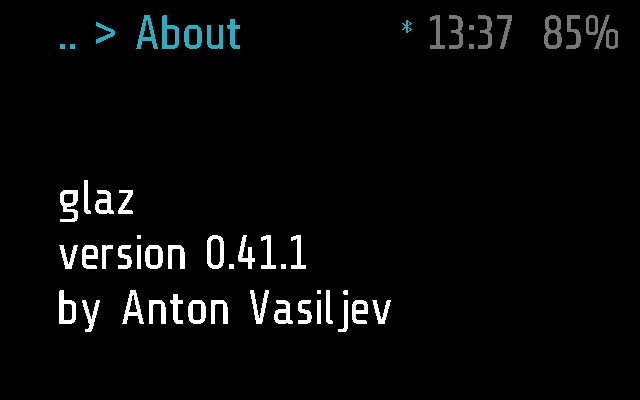
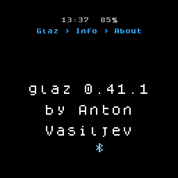
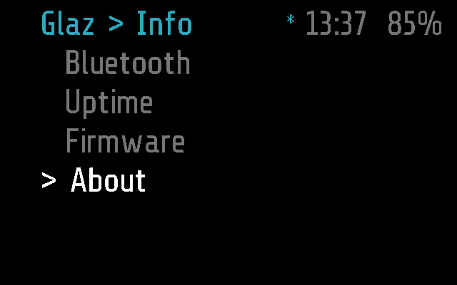

# About

The app's name, version and author, on the glasses. Use it to see which
version of glaz is on them, for example after an Upload.

## Screenshots

Frame:

Halo:

Where it is picked, Glaz > Info > About (Frame; made by
`test_picked_in_the_menu_under_info` in
[test_about.py](test_about.py)):

## How it works

About is an `info` module, the default kind
([PROTOCOL.md, Modules](../../docs/PROTOCOL.md#modules)): `run()`
returns its text once, and the app clears the screen after
`INFO_TIMEOUT`, 5 s. It has no `tick()`, no input hooks and no
`remote()`, so the phone cannot call it (`MODULE_CALL`).

- **Opening it.** Glaz > Info > About, a tap on the blank screen when it
  was the last app, or the phone's `APP_OPEN` (the Menu tab). An
  argument from the phone is ignored.
- **The text.** Three lines: `glaz`, `version <VERSION>`, `by <AUTHOR>`.
  The version is `VERSION` in [about.lua](about.lua), bumped by hand with
  every change to the glasses' side (see AGENTS.md, Rules); it is not read
  from git, because the glasses never see the repository.
- **Input.** A single tap, a tilt, the remote's arrows and Halo's button
  change nothing; a tap does not keep it on screen longer. A double tap
  (the arm's or the remote's Back) goes back to the Info menu, the
  remote's Menu shows the menu, three taps put the glasses to sleep
  ([PROTOCOL.md, States](../../docs/PROTOCOL.md#states)).
- **Background.** None: it stops when it leaves the screen, and after
  `INFO_TIMEOUT` the screen is blank. A notification covers it while it
  is shown.

### Frame and Halo

- **Frame** ([about.frame.lua](about.frame.lua)): an empty part, so
  `about.lua` builds the three lines itself, drawn left-aligned under the
  top bar.
- **Halo** ([about.halo.lua](about.halo.lua)): the round screen's text
  rows hold 14, 13 and 11 characters (`D.fit` in `glaz.halo.lua`), so the
  part's `lines()` lays them out to fit: `glaz <version>`, then the author
  split at the last space, `by Anton` and `Vasiljev`.

See [DEVICES.md](../../docs/DEVICES.md) for how a module gets its part.

## Files

- [about.lua](about.lua) -- the module: label, version, author.
- [about.frame.lua](about.frame.lua) -- Frame's part, empty.
- [about.halo.lua](about.halo.lua) -- Halo's part, `lines()`.
- [test_about.py](test_about.py) -- the tests, on
  emulated Frame and Halo: the version is SemVer and the file ASCII, the
  lines in order, the timeout, the inputs, Halo's layout.
