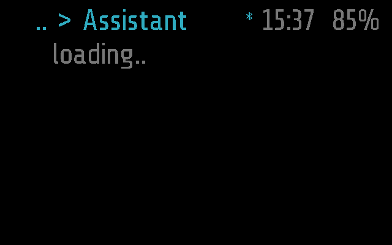
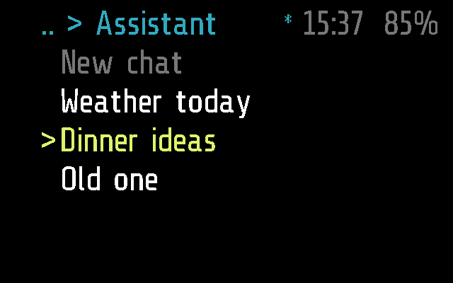
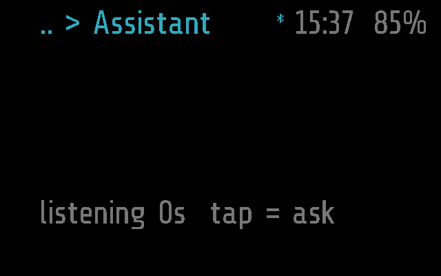
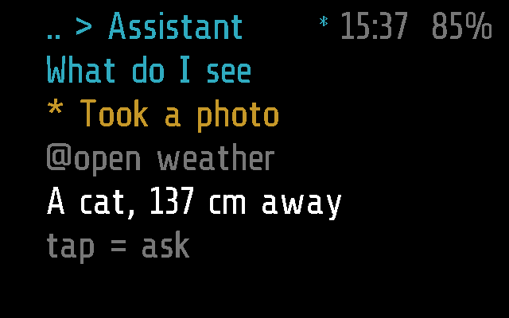

# Assistant

A voice assistant on the glasses. Tap, ask a question out loud, tap
again; the phone hears it, asks an AI agent and shows the answer on the
glasses. The chats are kept on the phone and can be picked up again.

Frame only: the app has no Halo part, so the phone neither uploads it to
Halo nor lists it there ([DEVICES.md](../../docs/DEVICES.md)).

## Screenshots

Frame, 2 s after opening (`python scripts/screenshots.py --readme`): the
chats are asked for.

The chats, newest first under `New chat`, the cursor on the one still
going on (`test_lists_the_chats_with_the_cursor_on_the_live_one`):

Listening, after a tap on `New chat`
(`test_new_chat_tells_the_phone_and_listens_at_once`):

A chat, coloured by kind: the question, a tool call, a command, the
answer (`test_a_chat_is_drawn_coloured_by_kind`):

The tests are in [test_assistant.py](test_assistant.py);
`SHOTS=<dir> pytest apps/assistant/test_assistant.py` saves these screens
([TESTING.md](../../docs/TESTING.md)).

## How it works

A sleeping `app` module (`_M.mode = 'app'`, no `_M.background`): it
stops when it leaves the screen. It draws the screen itself
(`_M.quiet`, `draw()`), in five rows under the top bar.

**Views.** Opened from the menu, it lists the chats; opened by the
phone with an argument (`APP_OPEN 'assistant'`), it goes straight to the
chat.

| Input | The chats | A chat | Listening |
| --- | --- | --- | --- |
| tilt right / left | the next / previous chat | a screen on / back; at the end it follows again | as in a chat |
| tap | `New chat`: listen at once, in a new chat; a chat: open it | listen; the answer comes in this chat | stop and ask |
| double tap | back to the menu | back to the chats, asked for again | the question is dropped, back to the chats |

A chat shows four rows of its log and a status row: `listening 5s  tap
= ask`, `thinking..`, `tap = ask`, or a note such as `no phone` or `no
microphone` in red. `^` in the status row means the view is not at the
end; `lost N K` means sound the Bluetooth link did not take. Colours:
questions sky blue, tool calls orange, answers white, commands grey,
errors red. Text is UTF-8: the font has Cyrillic.

**Listening.** Only taps start and stop it; nothing guesses where a
question ends. The sound is Recorder's streaming: `REC_START` with a
fourth byte `1` (for the assistant), then `AUDIO` packets, `AUDIO_END`
on the tap that asks. 8 kHz, 16-bit unless Glaz > Menu > Assistant says
8. While listening `busy()` is true, so `APP_TIMEOUT` (60 s without
input) does not close it; it asks by itself after 120 s. Going back or
leaving while listening or waiting sends `REC_DROP` (`0x10`): the phone
asks nothing, or throws the answer away.

**What it asks of the phone.** `ASSIST` (`0x04`, `>BBI2`: op, id): `1`
the chats (again every 5 s until they come), `2` go on with chat `id`,
`3` a new chat, sent just before listening. The phone answers through
`remote()` (`MODULE_CALL`) or `APP_OPEN 'assistant'` with an argument:
`c:` the chats, `t:` the chat's newest lines and whether the agent is
thinking, `e:` an error outside a chat, `listen`, `stop`. `APP_OPEN`
brings Assistant back on screen for the answer even if the wearer went
elsewhere.

The phone ([assistant.dart](../../flutter-glaz/lib/services/assistant.dart))
transcribes the sound with ML Kit, asks an agent with the OpenAI chat
completions API (Hermes Agent, [HERMES.md](../../docs/HERMES.md)), keeps
the newest 50 chats, runs the commands in the answer (`@open`,
`@notify`, `@set`, `@press`) and the queries (`@photo`, `@photos`,
`@getphoto`, `@recordings`, `@transcript`), and reads the answer aloud
in headphones only. All of it, with the wire format, is in
[PROTOCOL.md, Assistant](../../docs/PROTOCOL.md#assistant).

**Settings** (Glaz > Menu > Assistant, on the phone): the language
heard, `bits` (8 or 16), reading answers aloud, and whether the agent may
use the photos and recordings. The glasses read only `bits`. The agent
itself -- server, key, model -- is the AI agent service's (Glaz > More >
Services), which Factchecker shares; the page links to it.

## Files

- [assistant.lua](assistant.lua) -- the app
- [assistant.frame.lua](assistant.frame.lua) -- its part for Frame,
  empty
- [test_assistant.py](test_assistant.py) -- its
  tests
- [../../flutter-glaz/lib/services/assistant.dart](../../flutter-glaz/lib/services/assistant.dart)
  -- the phone side
