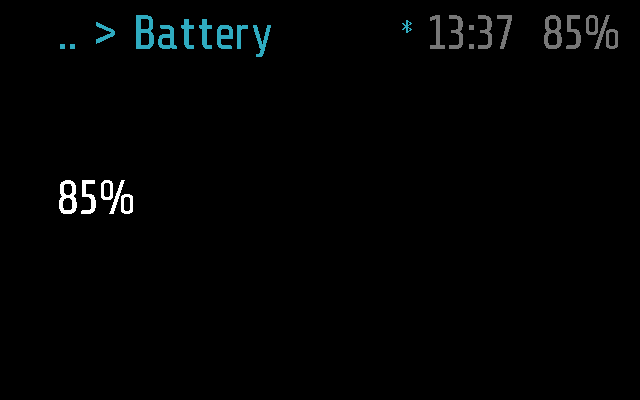
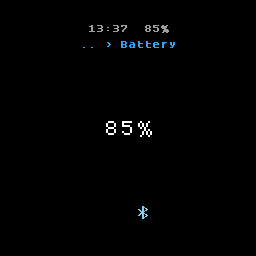

# Battery

The glasses' battery level in percent, shown for a few seconds.

## Screenshots

Frame:

Halo:

A reading of 37% while the top bar still says 85% (Frame; made by
`test_shows_the_level_in_percent` in
[test_battery.py](test_battery.py)). The module shows the
firmware's reading of the moment; the top bar shows the mean of its
samples:

## How it works

Battery is an `info` module, the default kind
([PROTOCOL.md, Modules](../../docs/PROTOCOL.md#modules)), and the example
there. `run()` returns `frame.battery_level()` formatted as `%d%%`, once,
when it opens; the app clears the screen after `INFO_TIMEOUT`, 5 s.

- **Opening it.** Glaz > Sensors > Battery, a tap on the blank screen when
  it was the last app, or the phone's `APP_OPEN` (the Menu tab). Each
  opening reads the level again; while it is shown the value is not
  refreshed.
- **Input.** A single tap or a tilt changes nothing, and a tap does not
  keep it on screen longer. A double tap (the arm's or the remote's Back)
  goes back to the Sensors menu; three taps put the glasses to sleep
  ([PROTOCOL.md, States](../../docs/PROTOCOL.md#states)).
- **The phone.** It has no `remote()`, so `MODULE_CALL` does nothing. The
  phone gets the battery level on its own, through `STATUS_GET`, not
  through this module ([PROTOCOL.md, Status](../../docs/PROTOCOL.md#status)).
- **The top bar and the module differ.** The top bar shows a smoothed
  percentage, the mean of its samples; the module shows the reading of the
  moment. The reading is noisy
  ([BATTERY.md](../../docs/BATTERY.md#the-reading-is-noisy)), so the two
  can be a few percent apart.
- **Errors.** Frame's firmware returns a float (`37.0`), which `%d` takes.
  A value without an integer representation would make `run()` fail: the
  screen shows `err: ...`, the error is printed once for the phone's log,
  and the app carries on.

### Frame and Halo

Both parts ([battery.frame.lua](battery.frame.lua),
[battery.halo.lua](battery.halo.lua)) are empty: `frame.battery_level()`
is the same on both ([DEVICES.md](../../docs/DEVICES.md)).

## Files

- [battery.lua](battery.lua) -- the module.
- [battery.frame.lua](battery.frame.lua) -- Frame's part, empty.
- [battery.halo.lua](battery.halo.lua) -- Halo's part, empty.
- [test_battery.py](test_battery.py) -- the tests,
  on emulated Frame and Halo.
