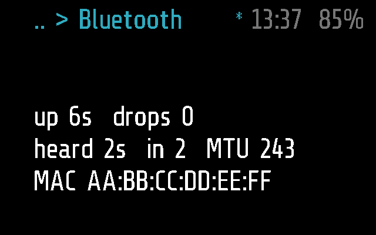
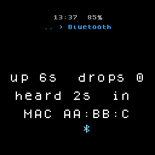
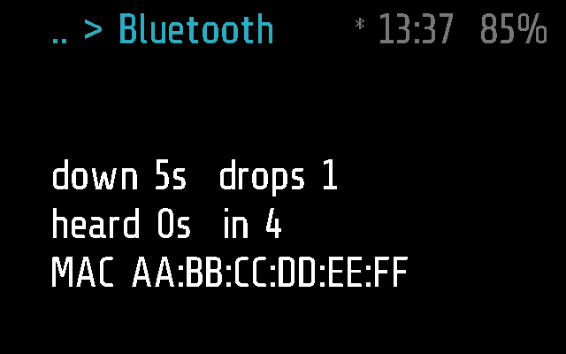
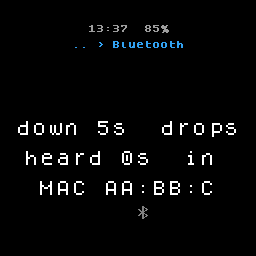

# Bluetooth

The Bluetooth link between the glasses and the phone, at a glance: up or
down and for how long, how often it dropped, when the phone last spoke.
Use it when the phone seems not to reach the glasses.

## Screenshots

Frame:



Halo:



The link lost, 5 s after the drop, on Frame and on Halo (made by
`test_a_drop_and_the_way_back_on_every_device` in
[test_bluetooth.py](test_bluetooth.py)):




## How it works

Bluetooth is an `app` module, sleeping (`background = false`)
([PROTOCOL.md, Modules](../../docs/PROTOCOL.md#modules)). The app calls
its `tick()` every `APP_TICK_PERIOD` (0.25 s) while it is on screen and
redraws when the text changes, so the times count up live.

**The three lines:**

```
up 5m12s  drops 3
heard 4s  in 137  MTU 243
MAC AA:BB:CC:DD:EE:FF
```

- `up` or `down`, from `frame.bluetooth.is_connected()`; a call that fails
  reads as down. Then how long it has been so, and the drops since boot.
- `heard`: how long ago the phone last sent anything, `-` before it ever
  has; `in`: the messages taken since boot. The phone asks for `STATUS`
  every minute, so `heard` past a minute with the link up means its app is
  gone or stuck ([PROTOCOL.md, Status](../../docs/PROTOCOL.md#status)).
- `MTU`, from `frame.bluetooth.max_length()`, only while the link is up:
  it is the one negotiated with the current host.
- `MAC`, from `frame.bluetooth.address()`, as the firmware builds it:
  lowest byte first, the reverse of what AR Studio and macOS show
  ([FRAME.md](../../docs/FRAME.md)).

Times are shown as `37s`, `5m12s`, or `2h05m` from an hour on.

**Where the numbers come from.** Only `is_connected`, `address` and
`max_length` are the firmware's. The rest is `glaz_link`, a global table
the app's main loop in [glaz.lua](../../glaz/glaz.lua) keeps: `up`,
`since` (when the link last went up or down), `drops`, `rx` (messages
taken) and `heard`. Without that table the module shows only what the
firmware gives. When the link comes back the loop also prints a line to
the phone's log, `link back after 3s down, 2 drops, 137 in`
([PROTOCOL.md, Keeping the link](../../docs/PROTOCOL.md#keeping-the-link)).

**Input and timers.** It has no input hooks. A single tap only keeps it
open; with no tap it closes after `APP_TIMEOUT`, 60 s. A double tap goes
back to the Info menu, three taps put the glasses to sleep
([PROTOCOL.md, States](../../docs/PROTOCOL.md#states)). Leaving the screen
stops it: it never runs in the background.

**The phone.** Nothing is asked of it, and it has no `remote()`. The
phone's own view of the link is Glaz > Connection details and the log
(More > Log, kind `link`).

### Frame and Halo

Both parts ([bluetooth.frame.lua](bluetooth.frame.lua),
[bluetooth.halo.lua](bluetooth.halo.lua)) are empty: the same three lines
go to both. On Halo's round screen the lines are cut to its text rows, so
the MTU, the number after `in` and most of the MAC do not show (see the
Halo screenshots); [test_bluetooth.py](test_bluetooth.py)
checks the MTU and the whole MAC on Frame only. Halo's `max_length()` is
the MTU less 1 ([HALO.md, Bluetooth](../../docs/HALO.md#bluetooth)).

## Files

- [bluetooth.lua](bluetooth.lua) -- the module.
- [bluetooth.frame.lua](bluetooth.frame.lua) -- Frame's part, empty.
- [bluetooth.halo.lua](bluetooth.halo.lua) -- Halo's part, empty.
- [../../glaz/glaz.lua](../../glaz/glaz.lua) -- `glaz_link`, kept by the
  main loop.
- [test_bluetooth.py](test_bluetooth.py) -- the
  tests, on emulated Frame and Halo: counting, drops and reconnects, the
  time formats, the timeout.
