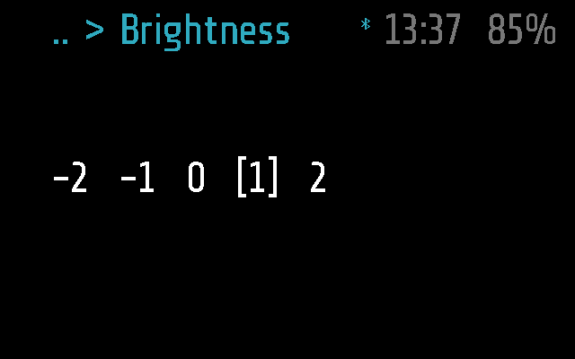
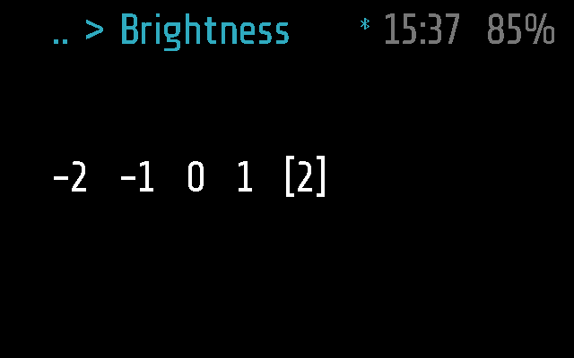
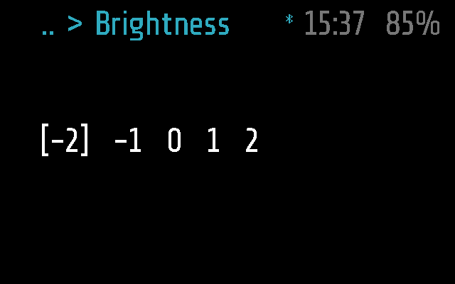

# Brightness

Picks how bright the display of the glasses is, on a scale of five levels,
from -2 to 2. The level changes as you tilt, so you see it before you
keep it. Frame only.

## Screenshots

Frame:

There is no Halo screenshot: Brightness does not run on Halo (see below).

Level 2 previewed after a few tilts: the panel already shows that level,
not yet kept (made by
`test_a_tilt_previews_the_level_live` in
[test_brightness.py](test_brightness.py)):

At the other end, -2 (made by `test_the_scale_stops_at_its_ends`):

## How it works

Brightness is an `app` module, sleeping (`background = false`), that takes
input itself ([PROTOCOL.md, Modules](../../docs/PROTOCOL.md#modules); it
is the example there for input hooks). It shows one line, the levels with
brackets round the one being previewed: `-2  -1  0  [1]  2`.

- **Tilt right / left** (`on_roll`): the next or previous level, applied
  to the panel at once with `frame.display.set_brightness()` as a preview.
  At either end of the scale a tilt does nothing.
- **Single tap** (`on_tap`): keep the previewed level; the module is done
  and the Settings menu comes straight back, the cursor on Brightness.
- **Double tap**: cancel. `stop()` sets the panel back to the level kept
  last, and the menu comes back.
- **Any other way out cancels too**: `APP_TIMEOUT` (60 s with no tap or
  tilt; a tilt counts as activity), three taps and deep sleep, the
  remote's Menu, the phone opening another app. Only a single tap changes
  the level for good.
- **The phone's remote** ([PROTOCOL.md, Remote](../../docs/PROTOCOL.md#remote))
  works the same: Right and Left move the level, and so do Down and Up,
  since the module has no `on_up_down`; OK keeps it, Back cancels. While
  the Remote tab is in front, head tilts are not read, but the remote's
  arrows are.
- The phone opening Brightness while it is on screen keeps the preview.
  It has no `remote()`, so `MODULE_CALL` does nothing.

**Where the level lives.** The firmware has no getter for the brightness,
so the module tracks it, in `frame.display.glaz_brightness`. Not in a
local: glaz drops a module when it stops and Frame's `require()` reads the
file again, so a local would be back at its default on every opening. Nor
in a global: after a crash glaz_boot clears the app's globals and starts it
again without a reboot, the panel still at the kept level, and the picker
would show the default and a cancel set the panel to it. `frame.display`
was there before glaz_boot looked, so the level lives as long as the
panel's register, and the picker reopens on the level kept last.

It is in RAM only. After a reboot, or a wake from deep sleep (which is a
reset), the panel is back at the firmware's default and so is the picker.
That default is 1, not 0: at boot the firmware writes `0xCB` to the
panel's luminosity register, which is what `set_brightness(1)` writes. The
level is not saved to a file. A brighter panel costs more battery; that
has not been measured
([BATTERY.md](../../docs/BATTERY.md#3-brightness-persists-at-whatever-level-was-last-chosen)).

### Frame and Halo

Brightness has a Frame part only ([brightness.frame.lua](brightness.frame.lua),
empty): `brightness.lua` uses Frame's API as it is. Without a Halo part
the phone neither uploads it to Halo nor lists it there, and Halo ignores
the phone's `APP_OPEN` for it ([DEVICES.md](../../docs/DEVICES.md)). Halo
has `set_brightness(-2..2)` as well
([HALO.md](../../docs/HALO.md)); bringing Brightness there needs a Halo
part.

## Files

- [brightness.lua](brightness.lua) -- the module.
- [brightness.frame.lua](brightness.frame.lua) -- Frame's part, empty.
- [test_brightness.py](test_brightness.py) -- the
  tests, on emulated Frame (and that Halo has no Brightness): preview,
  keep, cancel on every way out, the remote, the boot level.
