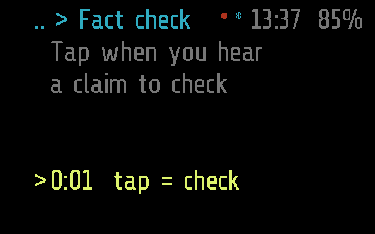
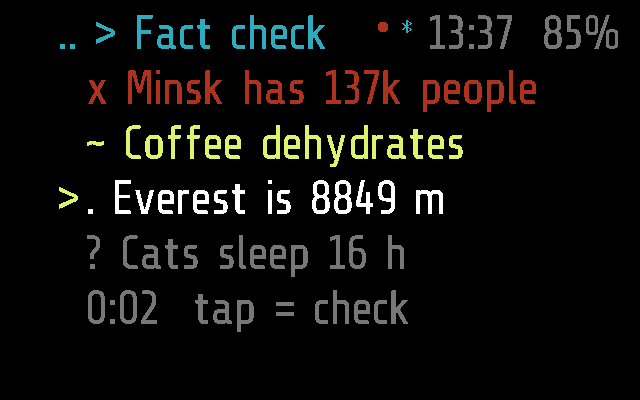
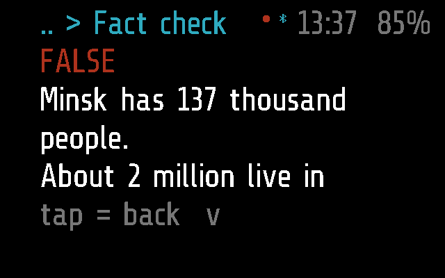
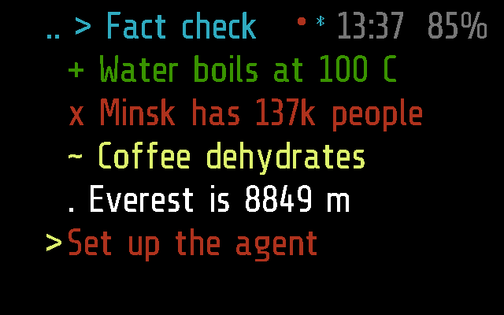

# Fact check

A fact checker for a conversation. Open it and it listens; when you hear a
claim worth checking, tap. The phone takes what was said since the last
tap, an AI agent picks out the claims in it and checks each, and they come
back to the glasses as a list: true in green, false in red, partly true in
yellow, unknown in grey. Tap one to read why.

Frame only: the app has no Halo part, so the phone neither uploads it to
Halo nor lists it there ([DEVICES.md](../../docs/DEVICES.md)).

## Screenshots

Frame, just opened (`python scripts/screenshots.py --readme`): listening,
the clock running, the cursor on the bottom row:

Nothing checked yet: a hint where the facts will be
(`test_opens_listening_and_asking_for_the_list`):

The facts, each with a mark and a colour -- `+` true, `x` false, `~`
partly, `?` unknown, `.` being checked -- the cursor on one
(`test_the_facts_are_marked_and_coloured_by_verdict`):

One fact opened: the verdict, the claim, why, the sources
(`test_a_tap_on_a_fact_opens_its_check`):

Something went wrong, in red in the bottom row
(`test_an_error_is_red`):

The tests are in [test_factcheck.py](test_factcheck.py);
`SHOTS=<dir> pytest apps/factcheck/test_factcheck.py` saves these screens
([TESTING.md](../../docs/TESTING.md)).

## How it works

A sleeping `app` module (`_M.mode = 'app'`, no `_M.background`): it
stops when it leaves the screen. It draws the screen itself
(`_M.quiet`, `draw()`): four rows of facts, oldest first, and a bottom row
under them that is both the status and the button.

| Input | The list, cursor on the bottom row | The list, cursor on a fact | A fact open |
| --- | --- | --- | --- |
| tilt left / right | up to the newest fact | up / down; below the newest, the bottom row | a screen back / on |
| tap | check what was said since the last tap; paused: listen again | open it | back to the list |
| double tap | leave | leave | back to the list |

**Made to be glanced at.** A verdict is a mark as well as a colour, so it
does not hang on telling red from green through the lens. A tap shows
`reading..` at once, before the phone has said anything. With the cursor
on the bottom row the list keeps to the newest facts; on a fact, the
cursor stays on it as others come. Notes from the phone (`No facts in
that`) go after 5 s; `no phone` and `paused (30 min)` stay while they
hold. With nothing checked yet, the rows say what to do.

**Listening.** It listens from the moment it opens, until it is left or
after 30 minutes (`paused (30 min)`; a tap listens again); the red dot in
the top bar shows it (`_M.rec`). The sound is Recorder's streaming:
`REC_START` with a fourth byte `4` (for Fact check), then `AUDIO`
packets; there is no `AUDIO_END`, the sound has no end, only cuts. 8 kHz,
16-bit unless Glaz > Menu > Fact check says 8. While listening `busy()`
is true, so `APP_TIMEOUT` (60 s without input) does not close it. The
link lost stops the microphone (`no phone`); back, it listens again and
asks for the list.

**What it asks of the phone.** `FACTS` (`0x01`, `>BBI2`: op, id): `3`
the list (on opening, again every 5 s until it comes, and when the link
is back), `1` check since the last cut, `2` open fact `id`, `0` the wearer
left. The phone answers through `remote()` (`MODULE_CALL`): `f:` the
facts, `d:` one fact's check, `e:` an error, `n:` a note. A `MODULE_CALL`
to it while it is not running starts it in the background, which does
nothing: it does not listen unless the wearer opened it.

The phone ([factcheck.dart](../../flutter-glaz/lib/services/factcheck.dart))
transcribes the sound with ML Kit as it comes, in the Assistant's
language, a new transcription from every cut. At a cut it asks the
Assistant's agent (Hermes Agent, [HERMES.md](../../docs/HERMES.md)) for
the checkable claims in the piece, then checks each, in parallel, on the
web; it keeps the sessions with their sources. All of it, with the wire
format, is in [PROTOCOL.md, Fact check](../../docs/PROTOCOL.md#fact-check).

**Settings** (Glaz > Menu > Fact check, on the phone): `bits` (8 or 16).
The agent and the language are the Assistant's.

## Files

- [factcheck.lua](factcheck.lua) -- the app
- [factcheck.frame.lua](factcheck.frame.lua) -- its part for Frame,
  empty
- [test_factcheck.py](test_factcheck.py) -- its tests
- [../../flutter-glaz/lib/services/factcheck.dart](../../flutter-glaz/lib/services/factcheck.dart)
  -- the phone side
