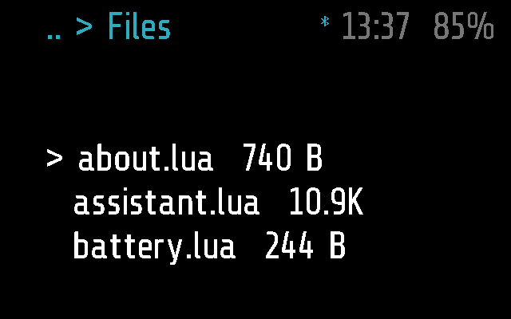
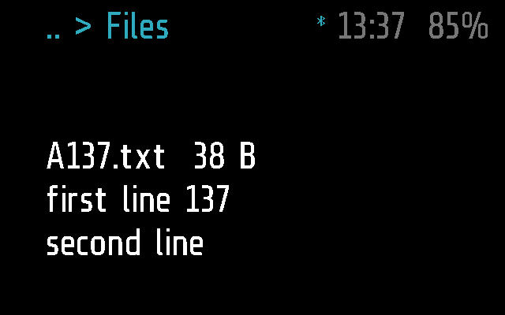

# Files

A look at the files stored on the glasses: their names and sizes, and the
first two lines of one. Viewing only: nothing is written or removed.

Apps > Files. Frame only.

## Screens

On Frame, 2 s after opening: the list, the cursor on the first file:

A tap on a file: its name and size, then its first two lines
(`test_a_tap_previews_name_size_and_first_two_lines`):

Made by [`test_files.py`](test_files.py) with
`SHOTS=dir`, as `files-preview.png`
([docs/TESTING.md](../../docs/TESTING.md)).

## How it works

The module reads the root folder once, in `start()`, with
`frame.file.listdir('/')`, leaves out `.` and `..`, and sorts the entries
by name. A file shows its size in bytes under 1 KB (`38 B`), in kilobytes
from there (`1.3K`); a folder shows its name with a `/` and no size. The
root is flat in practice: the phone uploads everything there. A file added
while the app is open shows only the next time it is opened.

A module gets three rows of text, so the list is a window of three files,
the cursor kept in the middle row where it can be. Lines are clipped to
about 26 characters, counted as UTF-8 characters, with `..` at the end.

| Gesture | List | Preview |
| --- | --- | --- |
| tilt right / left | next / previous file; wraps round at either end | nothing |
| tap | preview the file under the cursor | back to the list |
| double tap | back to the menu | back to the list (`on_back`) |

The phone's remote (Glaz > Remote) moves the cursor too: its tilts come in
as the wearer's do (`INPUT`, [docs/PROTOCOL.md](../../docs/PROTOCOL.md),
"Remote").

The preview opens the file with `frame.file.open(name, 'read')` and reads
two lines (the firmware reads a line at a time); `cannot open` when it
fails. A folder's preview says `(directory)`. With no files at all the
screen says `no files`.

The module is kind `app` with `_M.background = false`: it stops as soon as
it leaves the screen, and `stop()` drops the list. Like any `app` module it
closes after a minute without a gesture (`APP_TIMEOUT` in
[`glaz/glaz.lua`](../../glaz/glaz.lua)). It asks nothing of the phone and
has no settings.

The phone has a file browser of its own, Glaz > Glasses > Files, which
reads the same files through `glaz.lua` (`FILES_GET`, `FILE_GET`;
[docs/PROTOCOL.md](../../docs/PROTOCOL.md), "Files"); that one is not this
module.

**Frame and Halo.** `files.lua` uses Frame's API as it is, so the app
has only a Frame part, empty; the phone neither uploads it to Halo nor
lists it there ([docs/DEVICES.md](../../docs/DEVICES.md)).

## Files

- [`files.lua`](files.lua) -- the app
- [`files.frame.lua`](files.frame.lua) -- its part for Frame: nothing of
  its own
- [`test_files.py`](test_files.py) -- its tests, on
  emulated Frame (and that Halo has no Files)
