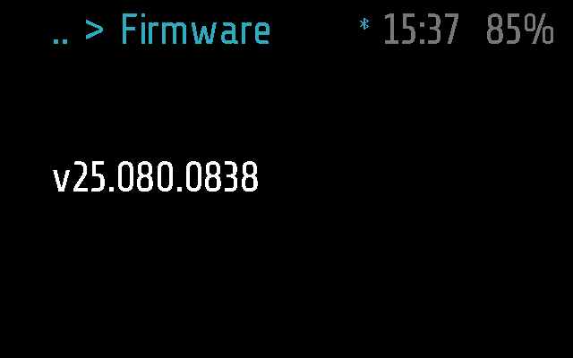
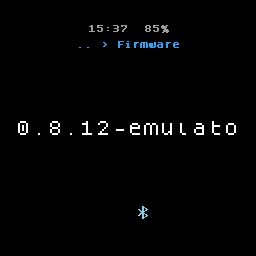
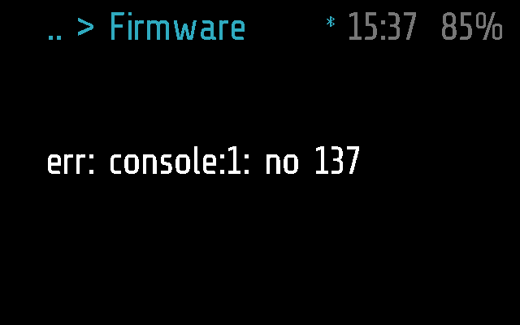

# Firmware

The version of the firmware the glasses run, for a few seconds. Use it to
check which firmware is on them, for example after an update from the
phone.

## Screenshots

Frame:

Halo:

A version that cannot be read: the error instead, and the app carries on
(Frame; made by `test_a_version_that_cannot_be_read_shows_the_error` in
[test_firmware.py](../../tests/test_firmware.py), which makes reading
the version raise `no 137`):

## How it works

Firmware is an `info` module, the default kind
([PROTOCOL.md, Modules](../../docs/PROTOCOL.md#modules)). `run()` returns
`frame.FIRMWARE_VERSION`, for example `v25.080.0838`, read again on each
opening; the app clears the screen after `INFO_TIMEOUT`, 5 s.

- **Opening it.** Glaz > Info > Firmware, a tap on the blank screen when
  it was the last app, or the phone's `APP_OPEN` (the Menu tab). An
  argument from the phone is ignored.
- **Input.** A single tap, a tilt and the remote's arrows leave it on
  screen as it is; a tap does not keep it longer than `INFO_TIMEOUT`. A
  double tap (the arm's or the remote's Back) goes back to the menu it was
  picked from, or to Info when the phone opened it; the remote's Menu
  shows the menu; three taps put the glasses to sleep
  ([PROTOCOL.md, States](../../docs/PROTOCOL.md#states)). A notification
  covers it, and it still goes in time.
- **The phone.** It has no `remote()`, so `MODULE_CALL` does nothing. The
  phone gets the same version on its own, in the answer to `STATUS_GET`
  ([PROTOCOL.md, Status](../../docs/PROTOCOL.md#status)), not through this
  module.
- **The version string.** It is what the firmware build stamps in. Our own
  builds carry a suffix, so they can be told from official releases
  ([FIRMWARE.md, Step 2, in practice](../../docs/FIRMWARE.md#step-2-in-practice)).
  A number instead of text is shown as text; a long one is drawn without
  trouble (cut to the round screen on Halo).
- **Errors.** If reading the version fails, `run()` fails: the screen
  shows `err: ...`, the error is printed for the phone's log
  (`Firmware err: ...`), and the screen clears after `INFO_TIMEOUT` as
  usual.

### Frame and Halo

Both parts ([firmware.frame.lua](firmware.frame.lua),
[firmware.halo.lua](firmware.halo.lua)) are empty:
`frame.FIRMWARE_VERSION` is there on both
([DEVICES.md](../../docs/DEVICES.md)). On Halo the text is cut to the
round screen's row: the emulator's `0.8.12-emulator` shows as
`0.8.12-emulato`.

## Files

- [firmware.lua](firmware.lua) -- the module.
- [firmware.frame.lua](firmware.frame.lua) -- Frame's part, empty.
- [firmware.halo.lua](firmware.halo.lua) -- Halo's part, empty.
- [../../tests/test_firmware.py](../../tests/test_firmware.py) -- the
  tests, on emulated Frame and Halo: the version shown and the one the
  phone gets, the timeout, the inputs, errors.
