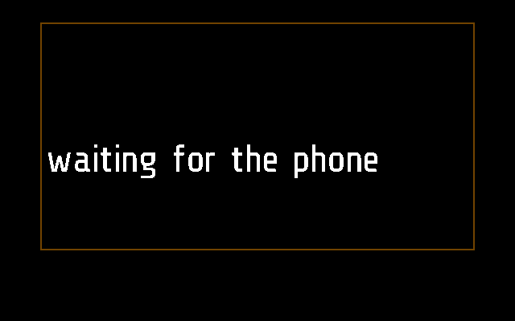
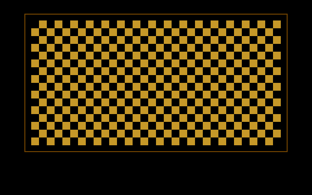

# Flipper

A Flipper Zero's screen on the glasses. You hold the Flipper and press its
buttons as usual; the picture is in front of your eye, four times the size,
in orange on black. The phone connects to the Flipper and passes its screen
on.

Apps > Flipper. Frame only.

## Screens

On Frame, 2 s after opening, before the phone has sent anything:

A whole Flipper screen drawn, a checkerboard here
(`test_a_whole_screen_in_one_frame`):

The phone's words instead of a picture, when it has none to send
(`test_the_phones_words_replace_the_picture`):

Both are made by [`tests/test_flipper.py`](../../tests/test_flipper.py),
with `SHOTS=dir`, as `flipper.png` and `flipper-status.png`
([docs/TESTING.md](../../docs/TESTING.md)).

## How it works

The module only draws. The phone holds the Flipper over Bluetooth (its RPC),
takes the Flipper's 128x64 screen each time it changes and sends the
glasses the rows that changed. The whole path, the Flipper's side and
pairing are in [docs/FLIPPER.md](../../docs/FLIPPER.md).

**Asking the phone.** From its first `tick()` the module sends `FLIPPER`
`[0x0B, 1]`, and again every 3 s (`ASK_AGAIN`) until the phone says
anything. It sends `[0x0B, 0]` when it stops. The phone side is
[`flutter-glaz/lib/services/flipper.dart`](../../flutter-glaz/lib/services/flipper.dart),
the Flipper screen service (More > Services).

**What the phone sends.** `MODULE_CALL` `flipper`, into `remote(arg)`:

| Argument | Means |
| --- | --- |
| `'f' seq mask rows` | a frame: `seq` one byte, `mask` 8 bytes with a bit a row (row 0 the high bit of the first), then 32 bytes for each row whose bit is set, a nibble a byte |
| `'s' text` | no picture, and why (`looking for the Flipper`, `no Flipper found`); the picture is cleared and the text shown |

Each frame is answered with `FLIPPER` `[0x0B, 2, seq]`. The phone sends the
next frame only after that answer, and every row again if none comes within
1.5 s ([docs/PROTOCOL.md](../../docs/PROTOCOL.md), "One message per code at
a time"). A message too short for its mask is ignored; a row cut short is
left blank.

**What it shows.** The module keeps the 64 rows, 32 bytes each; a blank row
is not kept. `draw()` draws each row as one `frame.display.bitmap`, widened
four times with `string.gsub` and a 16-entry table, 512x256 at x 65, y 43:
the middle of the visible 640x340. A set bit is ORANGE. Round it, 12 px
away, a 2 px frame in BROWN. `_M.fullscreen` leaves out the top bar.

Until the first frame the text is `waiting for the phone`, or the phone's
words. Without Bluetooth it shows `no phone`, drops the picture and asks
again once the link is back.

**Input.** None of its own reaches the Flipper: the Flipper's buttons drive
it. A tilt does nothing (no `on_roll`). A tap (`on_tap`) keeps it open; a
double tap closes it, and the phone lets the Flipper go.

**Timers.** `mode = 'app'`, not in the background: it stops as soon as it
leaves the screen. Frames from the phone count as input, so a changing
picture keeps it open past `APP_TIMEOUT` (60 s). But not past `IDLE`
(300 s) without a tap: the Flipper's desktop animates by itself and would
keep the display lit and the glasses awake for good. With the picture
standing still it closes after `APP_TIMEOUT` as any app does.

**Frame and Halo.** It runs on Frame only: `flipper.frame.lua` is empty,
and there is no `flipper.halo.lua`, so the phone neither uploads it to Halo
nor lists it there ([docs/DEVICES.md](../../docs/DEVICES.md)).

## Files

- [`flipper.lua`](flipper.lua) -- the module
- [`flipper.frame.lua`](flipper.frame.lua) -- its part for Frame, empty
- [`../../flutter-glaz/lib/services/flipper.dart`](../../flutter-glaz/lib/services/flipper.dart)
  -- the phone's side; the Flipper's protocol in `lib/flipper/`
- [`../../tests/test_flipper.py`](../../tests/test_flipper.py) -- its tests
