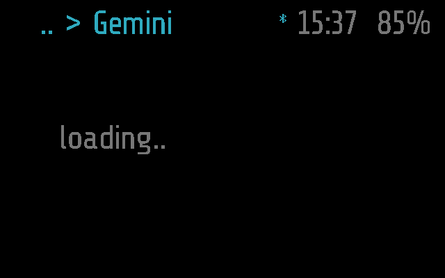
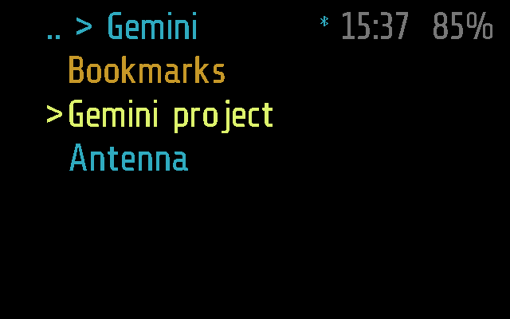
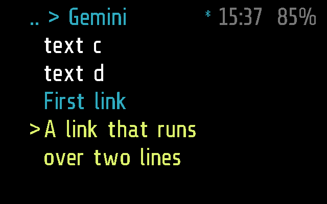
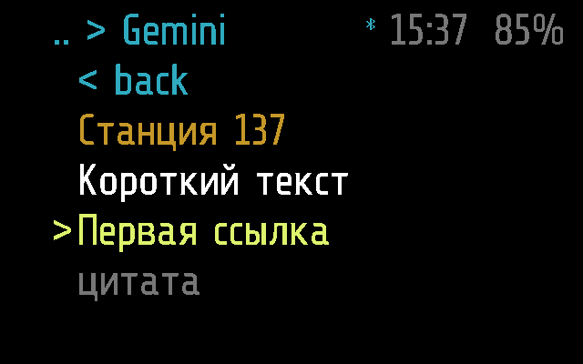

# Gemini

A browser for [Gemini](https://geminiprotocol.net), the small web of
plain text pages, on the glasses. The phone fetches the pages; the
glasses show them, and tilts and taps follow the links.

Frame only: the app has no Halo part, so the phone neither uploads it to
Halo nor lists it there ([DEVICES.md](../../docs/DEVICES.md)).

## Screenshots

Frame, 2 s after opening (`python scripts/screenshots.py --readme`):
the lines are asked for, no phone answers.

The home page, the bookmarks, the cursor on the first link
(`test_shows_the_home_page_with_the_cursor_on_its_first_link`):

A page scrolled down by tilting past the last link on screen; the link
under the cursor runs over two lines
(`test_tilting_past_the_last_link_on_screen_scrolls_down`):

A page in Cyrillic, with a heading, text, links and a quote
(`test_a_page_in_cyrillic`):

The tests are in [tests/test_gemini.py](../../tests/test_gemini.py);
`SHOTS=<dir> pytest tests/test_gemini.py` saves these screens
([TESTING.md](../../docs/TESTING.md)).

## How it works

A sleeping `app` module: it stops when it leaves the screen, but the
phone keeps the page open and where it was, so it is there on the next
visit. It draws the screen itself (`_M.quiet`, `draw()`), five rows
under the top bar.

| Input | Does |
| --- | --- |
| tilt right / left | the next / previous link on screen; past the last / first one, a screen down / up |
| tap | open the link under the cursor; with none, a screen down |
| double tap | back to the page before, as `< back`; on the home page or while a page is opening, back to the menu |

Colours by line kind: text white, headings orange, links sky blue (the
one under the cursor yellow, with `>`), quotes grey, preformatted green.
Instead of the page it may show `loading..`, `opening..`, `no phone`,
or `no answer, tap to retry` when a page did not come in 25 s (the phone
gives up at 15). A tap after a note asks again.

**What it asks of the phone.** The glasses hold a window of the page's
lines and ask for others as they scroll, only from `tick()`. `GEM_GET`
(`0x0D`, `>BBI2I2`: op, page, n, top): op `1` opens link `n` (`0` is
back, `65535` home), op `2` asks for lines from `n`. They ask again
after 5 s without an answer. The phone answers with `MODULE_CALL`
`gemini`: `p:<page>:<from>:<total>:<top>:<back>`, then a line each,
`<kind><link>|<text>`, as many as fit in 900 bytes. A new page number
makes the glasses drop what they hold. Details in
[PROTOCOL.md, Gemini](../../docs/PROTOCOL.md#gemini).

The phone ([gemini.dart](../../flutter-glaz/lib/services/gemini.dart))
fetches `gemini://` pages over TLS on port 1965, takes any server
certificate, follows up to five redirects, and wraps the gemtext into
lines that fit the screen. Every page but home starts with `< back` and
ends with `< back` and `home`. A link to another scheme opens a page
saying to open it on the phone.

**Settings** (Glaz > Menu > Gemini, on the phone): the bookmarks, which
are the home page, and the Internet permission, which fetching needs.

No background work and no `busy()`: `APP_TIMEOUT` closes it after 60 s
without input.

## Files

- [gemini.lua](gemini.lua) -- the app
- [gemini.frame.lua](gemini.frame.lua) -- its part for Frame, empty
- [../../tests/test_gemini.py](../../tests/test_gemini.py) -- its tests
- [../../flutter-glaz/lib/services/gemini.dart](../../flutter-glaz/lib/services/gemini.dart)
  -- the phone side
