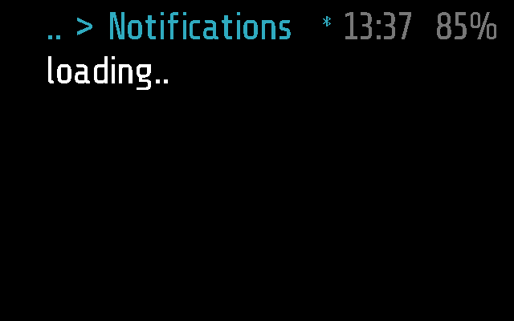
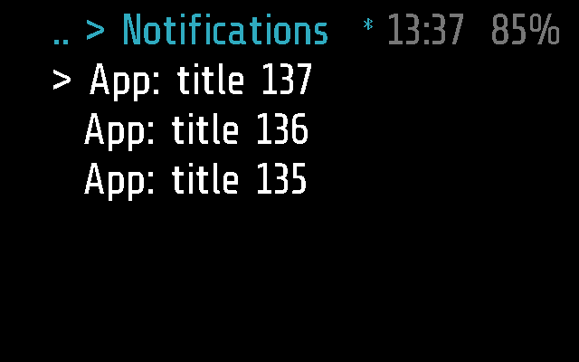
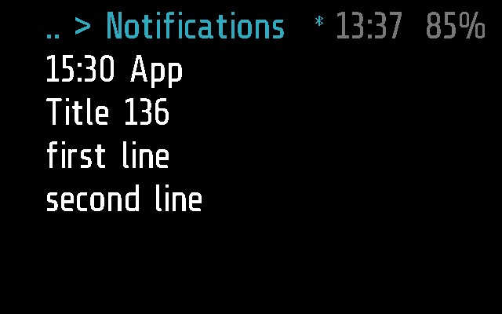

# Notifications

The phone's notifications on the glasses, newest first: a list to
scroll, and each one to open and read in full. Apps > Notifications.
How they pop up is set elsewhere, in Settings > Notifications
([notifyset](../notifyset/README.md)).

Frame only: the app has no Halo part, so the phone neither uploads it to
Halo nor lists it there ([DEVICES.md](../../docs/DEVICES.md)).

## Screenshots

Frame, 2 s after opening (`python scripts/screenshots.py --readme`): the
list is asked for.

The list, the cursor on the newest
(`test_shows_the_list_with_the_cursor_on_the_newest`):

One opened: the time and the app, the title, the text
(`test_a_tap_opens_one_and_shows_it_all`):

The tests are in
[test_notifications.py](test_notifications.py);
`SHOTS=<dir> pytest apps/notifications/test_notifications.py` saves these screens
([TESTING.md](../../docs/TESTING.md)).

## How it works

A sleeping `app` module: it stops when it leaves the screen, and asks
for the list again when it comes back. It shows five rows, every row
under the top bar (`_M.rows = 5`).

| Input | The list | One opened |
| --- | --- | --- |
| tilt right / left | the next (older) / previous (newer) one | a screen down / up |
| tap | open the one under the cursor | back to the list |
| double tap | back to the menu | back to the list |

Instead of the list it may show `loading..`, `no notifications`, or
`no phone` (a tap clears it, and it asks again).

**What it asks of the phone.** The list lives on the phone: the last 50
it forwarded, also those that came with the glasses away. The glasses
hold a window of it and ask for another as the cursor leaves it, only
from `tick()`, again after 5 s without an answer. `NOTICES_GET`
(`0x0E`, `>BI4`: op, n): op `1` the list from number `n` (0 the
newest), op `2` notification `n`, all of it. The phone answers with
`MODULE_CALL` `notifications`: `l:<from>:<total>` then `<id>|<app>:
<title>` a line, up to 10; or `f:<id>` then its lines. Lines come cut to
the screen. An answer to a request since replaced is dropped. Details in
[PROTOCOL.md, Notifications](../../docs/PROTOCOL.md#notifications).

The phone side is
[notifications.dart](../../flutter-glaz/lib/services/notifications.dart):
Android only, it forwards each notification as it comes (`NOTIFY`) and
keeps the list.

No background work and no `busy()`: `APP_TIMEOUT` closes it after 60 s
without input. No settings of its own.

## Files

- [notifications.lua](notifications.lua) -- the app
- [notifications.frame.lua](notifications.frame.lua) -- its part for
  Frame, empty
- [test_notifications.py](test_notifications.py)
  -- its tests
- [../../flutter-glaz/lib/services/notifications.dart](../../flutter-glaz/lib/services/notifications.dart)
  -- the phone side
