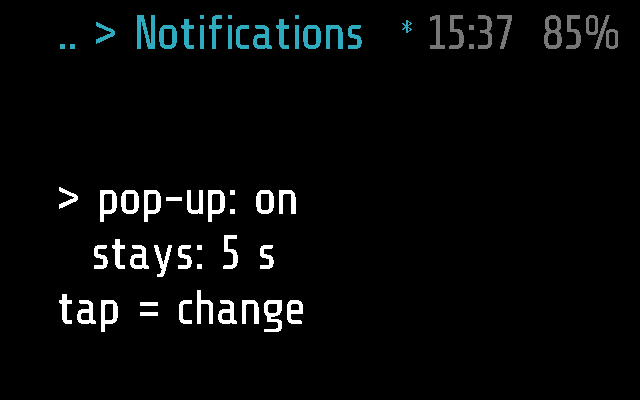
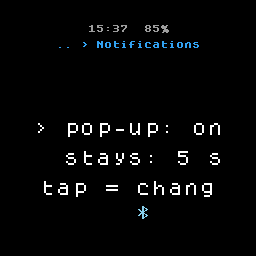
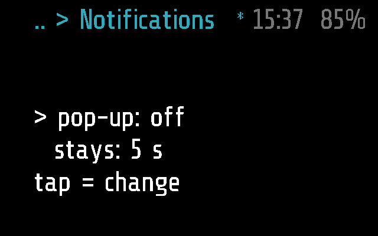
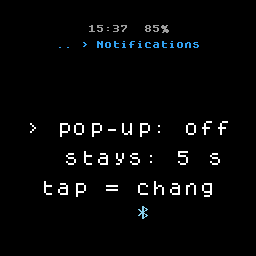
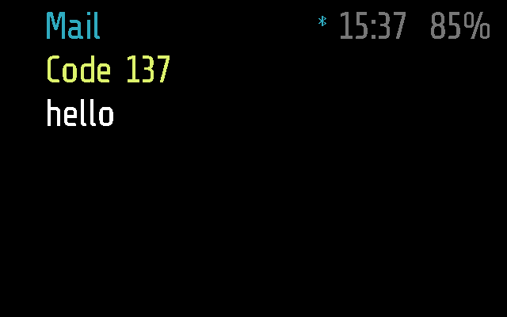
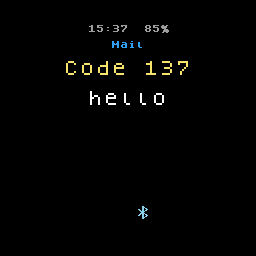

# Notifications (Settings)

How the phone's notifications pop up on the glasses: whether they do,
and how many seconds they stay. Picked on the glasses, in Settings >
Notifications; the menu label is `Notifications`, as the list in Apps
([notifications](../notifications/README.md)).

## Screenshots

2 s after opening (`python scripts/screenshots.py --readme`), the
defaults: pop-up on, 5 s.

Frame:

Halo:

After a tap: pop-up off (`test_a_tap_turns_the_pop_up_off_and_on`).
Frame, then Halo:

A notification popping up, as set here
(`test_by_default_a_notification_stays_five_seconds`). Frame, then
Halo:

The tests are in [tests/test_notifyset.py](../../tests/test_notifyset.py);
`SHOTS=<dir> pytest tests/test_notifyset.py` saves these screens
([TESTING.md](../../docs/TESTING.md)).

## How it works

A sleeping `app` module with two settings, one to a row, the cursor
`>` on the one picked, and `tap = change` under them.

| Setting | Values, the first the default |
| --- | --- |
| `pop-up` | `on`, `off` |
| `stays` | `5`, `3`, `10`, `20` seconds |

| Input | Does |
| --- | --- |
| tilt right / left | the next / previous setting, round |
| tap | its next value, round, kept at once |
| double tap | back to the menu |

The values are kept in `prefs.txt` on the glasses, through
`_M.host.pref()` / `_M.host.set_pref()`
([glaz_host.lua](../../glaz/glaz_host.lua)), as `notifyset.popup` and
`notifyset.seconds`. The phone's `SETTINGS_SET` leaves them alone.
Nothing is sent to the phone.

[glaz.lua](../../glaz/glaz.lua) reads them for every `NOTIFY` that
comes: off, the notification does not cover the screen (the phone
still keeps it for Apps > Notifications); on, it covers the screen for
the seconds picked, unless a tap dismisses it. See
[PROTOCOL.md, Notifications](../../docs/PROTOCOL.md#notifications).

The same on Frame and Halo: both parts are empty.

## Files

- [notifyset.lua](notifyset.lua) -- the app
- [notifyset.frame.lua](notifyset.frame.lua) -- its part for Frame,
  empty
- [notifyset.halo.lua](notifyset.halo.lua) -- its part for Halo, empty
- [../../tests/test_notifyset.py](../../tests/test_notifyset.py) -- its
  tests
