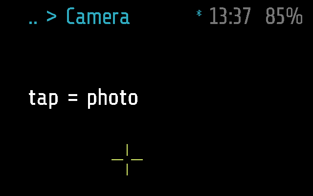
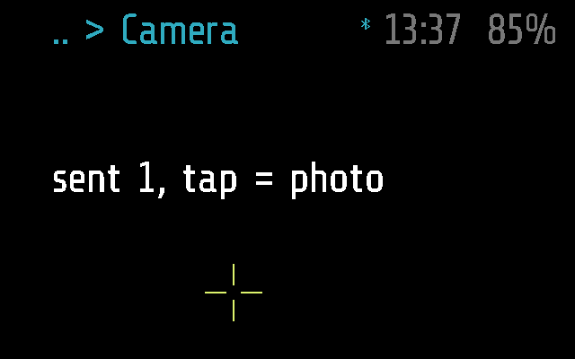

# Camera

Takes a photo with the glasses' camera at a tap and sends it to the phone,
which keeps it in its Photos tab. A yellow cross shows where the middle of
the photo will be.

Apps > Camera. Frame only. The file is `photo.lua`, not `camera.lua`, so
it is not confused with the camera library it uses (`camera.min`).

## Screens

On Frame, 2 s after opening, with the phone connected:

After a photo has gone to the phone (`test_a_tap_sends_a_photo`):

Made by [`test_photo.py`](test_photo.py) with
`SHOTS=dir`, as `camera-sent.png`
([docs/TESTING.md](../../docs/TESTING.md)). The same tests also save
`camera-no-host.png` and `camera-send-failed.png`.

## How it works

The glasses cannot show a JPEG (16 colours, no decoder), so a photo only
makes sense with the phone: it goes over Bluetooth and the phone saves it.

| Gesture | Does |
| --- | --- |
| tap | take a photo and send it |
| double tap | back to the menu (`glaz.lua`) |

**Opening.** `start()` powers the camera up (`frame.camera.power_save(false)`)
and notes the time. Every tick (4 a second) runs the camera's auto
exposure, so the picture is not dark. A tap within 1.5 s of opening
(`WARMUP`) first runs auto exposure until that time has passed.

**A tap.** With no phone connected the screen says `no host` and nothing is
taken. Otherwise the module sends `PHOTO_FROM` `[0x1A, 0]` (0: a single
shot, filed under the day rather than in a series folder), then
`camera.capture_and_send()` of the frame_msg camera library takes the
photo and sends it as `0x07` chunks and a final `0x08`. That blocks the
app's loop for the transfer, about 1 to 3 s at 512 px; taps made meanwhile
are handled afterwards. The screen then says `sent N, tap = photo`, or
`send failed, tap = photo` until a later photo goes through. Only
`capture_and_send()` and `run_auto_exposure()` are used from the library:
its other messages use `0x11` / `0x12`, which the menu uses already.

**The cross.** The camera sees far more than the display: the display is
about half the photo's width and a third of its height. So instead of a
frame round the photo, `draw()` puts a yellow cross where the photo's
centre falls, by default at (261, 327): left of the display's centre and
below it, as the camera sits on the bridge and the display before the
right eye. Measured at 60 cm; see [docs/PROTOCOL.md](../../docs/PROTOCOL.md),
"Photos".

**Settings** (phone: Menu > Camera; [docs/PROTOCOL.md](../../docs/PROTOCOL.md),
"Settings"), read at each shot:

| Key | Default | Means |
| --- | --- | --- |
| `resolution` | 512 | px, square; the phone offers 256, 512, 720. An odd value or one outside 100..720 falls back to 512 |
| `quality` | `MEDIUM` | JPEG quality, `VERY_LOW` to `VERY_HIGH`; anything else falls back to `MEDIUM` |
| `aim_x`, `aim_y` | 261, 327 | where the cross is, in display pixels; kept far enough from the edges for the whole cross |

**The phone.** [`flutter-glaz/lib/services/photos.dart`](../../flutter-glaz/lib/services/photos.dart)
receives the chunks, marks the JPEG as turned (the sensor is mounted at 90
degrees) and files it as `photos/<day>/<day> <time>-<ms>.jpg`; on Android
that is the shared `Pictures/Glaz`
([`photo_dir.dart`](../../flutter-glaz/lib/services/photo_dir.dart)).
The phone's own remote can also take a photo without this app
(`PHOTO_TAKE`, handled by `glaz.lua`).

**Leaving.** Kind `app`, `_M.background = false`: the module stops as soon
as it leaves the screen, and closes after a minute without a gesture
(`APP_TIMEOUT` in [`glaz/glaz.lua`](../../glaz/glaz.lua)). The camera is
powered only while it is open: `stop()` powers it down, unless Time series
is running in the background and still shooting with it; `glaz.lua` also
powers it down on its own exit paths (`release_hardware`).

**Frame and Halo.** `photo.lua` uses Frame's API as it is, so the
app has only a Frame part, empty; the phone neither uploads it to Halo nor
lists it there ([docs/DEVICES.md](../../docs/DEVICES.md)).

## Files

- [`photo.lua`](photo.lua) -- the app
- [`photo.frame.lua`](photo.frame.lua) -- its part for Frame: nothing of
  its own
- [`test_photo.py`](test_photo.py) -- its tests, on
  emulated Frame
