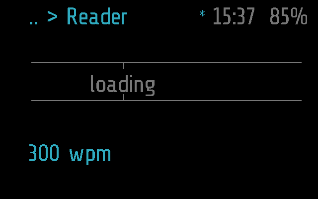
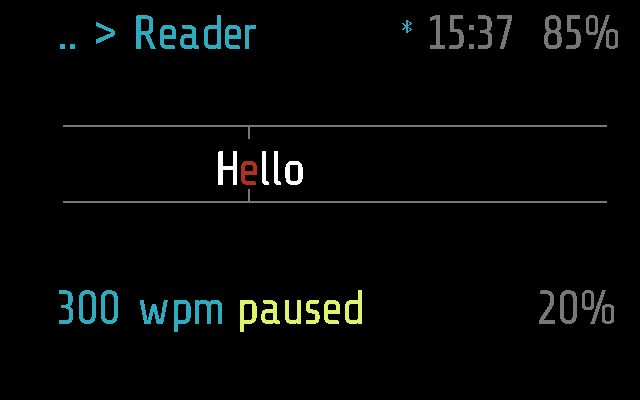
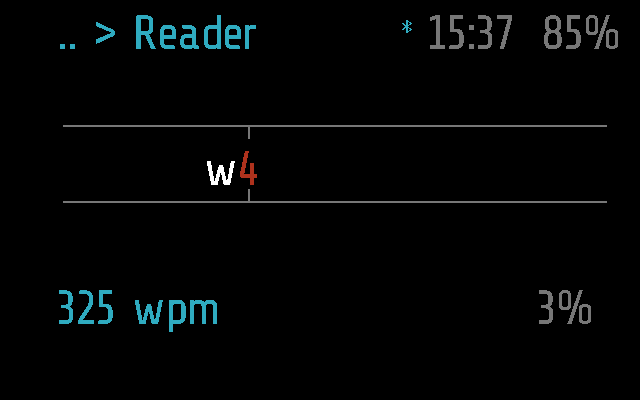
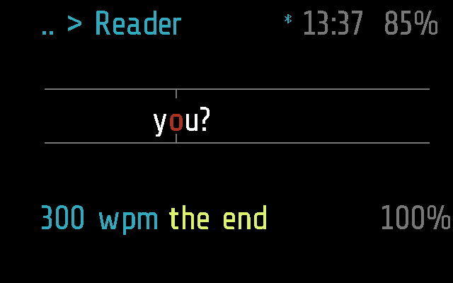

# Reader

A speed reader: a text from the phone, one word at a time, always at the
same spot, so the eye does not move. The speed in words a minute is always
on screen; the phone keeps the texts and the place in each.

Apps > Reader. Frame only.

## Screens

On Frame, 2 s after opening, before the phone has sent the words:

The first word comes paused, its pivot letter red
(`test_the_first_word_comes_paused_with_its_letter_red`):

Reading, sped up by a tilt from 300 to 325 wpm
(`test_a_tilt_while_reading_changes_the_speed`):

The last word of the text (`test_a_tap_reads_one_word_after_another_to_the_end`):

Made by [`test_reader.py`](test_reader.py) with
`SHOTS=dir`, as `reader-paused.png`, `reader-reading.png` and
`reader-end.png` ([docs/TESTING.md](../../docs/TESTING.md)). The same
tests also save `reader-loading.png`, `reader-no-text.png` and
`reader-no-phone.png`.

## How it works

| Gesture | Reading | Paused |
| --- | --- | --- |
| tap | pause | go on; at the end, again from the start |
| tilt | faster / slower by 25 wpm, 100 to 800 | back / on to the start of a sentence |
| double tap | leave; the phone keeps the place | the same |

**The screen.** The module draws it all (`_M.quiet`: its `tick()` text is
not shown). Two grey rules with a notch point at `x = 250`, a third of the
way across what the eye sees. The word's pivot letter -- the second of two
to five letters, the third of six to nine, and so on, punctuation not
counted -- is red and centred there; the part before ends at its left, the
part after starts at its right. Their widths come from the firmware
font's table, kept in the module as strings (ASCII, Latin-1, Cyrillic).
Under the rules: the speed, `paused` or `the end` in yellow, and how far
through in percent. Instead of a word: `loading`, `no text` with
`text: Glaz > Menu`, or `no phone` with `tap to retry` (a tap asks again).

**Timing.** The module is ticked every 0.02 s (`_M.period`). A word stays
`60 / wpm` seconds: twice that at the end of a sentence, 1.5 times after a
comma, colon or semicolon, 1.25 times for a word over eight characters.
The first word after a pause stays twice as long, so the eye finds it.
While reading the module is `busy()`, so the app's minute without a
gesture (`APP_TIMEOUT` in [`glaz/glaz.lua`](../../glaz/glaz.lua)) does not
close it; paused, it does. It is kind `app` with no `_M.background`: it
stops when it leaves the screen.

**The words come from the phone.** The glasses hold a few dozen words. From
`tick()` (never from `start()`) they send `TEXT_GET` (`0x0A`,
`>I4I4BI2B`: place, from, count, wpm, text): the first time from
`0xFFFFFFFF`, "the place you keep", then 60 words (`BATCH`) at a time when
fewer than 20 (`LOW`) are left ahead, again after 5 s without an answer.
They keep 30 words (`BEHIND`) behind the place for going back; a tilt back
past them asks the phone for the words from there. A `TEXT_GET` with count
0 only reports the place and the speed: on a pause, at the end, and on
leaving, if the module was on screen.

The phone answers with `MODULE_CALL` `reader` and
`t:from:total:text:words`, at most 300 bytes of words, fewer than asked
for when they do not fit: the glasses ask for the rest as they near its
end ([PROTOCOL.md, Memory on the
glasses](../../docs/PROTOCOL.md#memory-on-the-glasses)). A text number other than the one held means the
phone now reads another text: the glasses drop their words and start
there. `APP_OPEN` `reader` with `new` (the phone's Read on glasses) starts
again from the phone's place. The whole exchange is in
[docs/PROTOCOL.md](../../docs/PROTOCOL.md), "Reader".

**The phone.** [`flutter-glaz/lib/services/reader.dart`](../../flutter-glaz/lib/services/reader.dart)
keeps the library (Menu > Reader: paste or type a text, open it, rename,
delete, mark the one the glasses read) and the place in each text. It
prepares the words: only what the font has, and a word over 13
characters cut into pieces ending in `-`, so each fits right of the pivot.

**Settings** (phone: Menu > Reader): `wpm`, 300 by default. The glasses
follow a new setting also while reading. A tilt changes the speed on the
glasses only; the phone keeps it from the next report.

**Frame and Halo.** `reader.lua` uses Frame's API as it is,
so the app has only a Frame part, empty; the phone neither uploads it to
Halo nor lists it there ([docs/DEVICES.md](../../docs/DEVICES.md)).

## Files

- [`reader.lua`](reader.lua) -- the app
- [`reader.frame.lua`](reader.frame.lua) -- its part for Frame: nothing of
  its own
- [`test_reader.py`](test_reader.py) -- its tests, on
  emulated Frame (and that Halo has no Reader)
