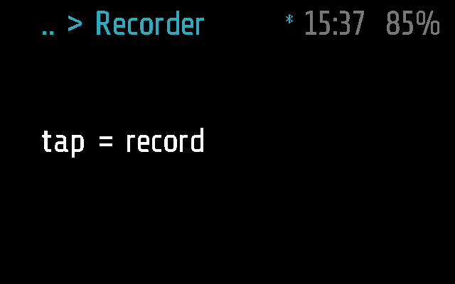
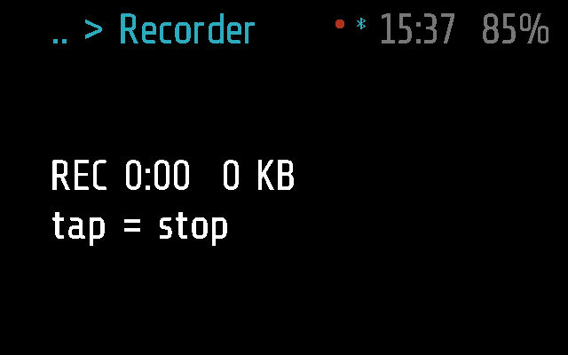
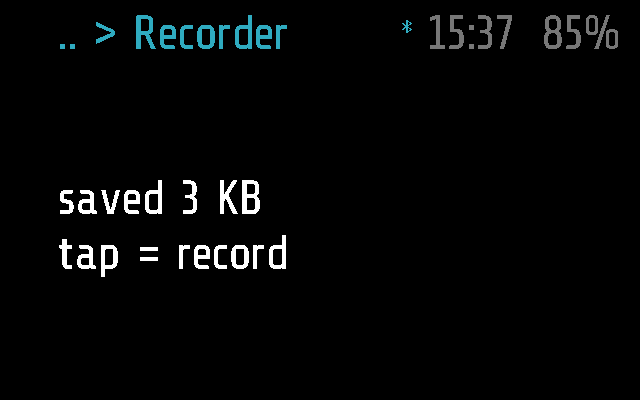
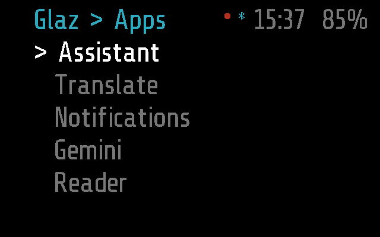

# Recorder

A voice recorder: a tap starts recording with the glasses' microphone, a
tap stops it. The sound goes to the phone as it is recorded, and the phone
saves it as a WAV file in its Voice tab. A recording goes on with the app
off screen.

Apps > Recorder. Frame only.

## Screens

On Frame, 2 s after opening, with the phone connected:

Recording (`test_a_tap_starts_8_bit_8_khz`); the red dot in the top bar
says a recording is on:

Stopped, with what went to the phone
(`test_a_second_tap_stops_and_tells_what_was_saved`):

Left with a double tap, the recording goes on in the background; the dot
stays in the top bar over the menu
(`test_left_recording_it_goes_on_in_the_background`):

Made by [`tests/test_recorder.py`](../../tests/test_recorder.py) with
`SHOTS=dir`, as `recorder-recording.png`, `recorder-saved.png` and
`recorder-background.png` ([docs/TESTING.md](../../docs/TESTING.md)). The
same tests also save `recorder-no-host.png` and `recorder-lost.png`.

## How it works

| Input | Does |
| --- | --- |
| tap | start / stop recording |
| double tap | back; a recording goes on in the background |
| phone, record button | `MODULE_CALL` `recorder\non` or `recorder\noff` |

**Starting.** With no phone connected the screen says `no host` and nothing
starts. Otherwise the module starts the microphone at 8 kHz and 8 or 16
bits (the `bits` setting), sends `REC_START` `[0x1F, bits, 8]` and sets
`_M.rec`, which puts the red dot in the top bar. The screen shows the time
and the kilobytes sent, `REC 0:05  3 KB`, and `tap = stop`.

**Sending.** The firmware buffers about 2 s of sound. Every tick empties
it into `0x05` packets as long as `frame.bluetooth.max_length()` allows, at
most two seconds' worth a tick. Whatever the link does not take is dropped,
never kept: the glasses have no room for it. It is counted, and shown as
`lost N KB`. Each packet is also a step of the garbage collector, or a few
seconds of reading run the glasses out of memory.

**Stopping.** A tap, `off` from the phone, or the module stopping: the
microphone stops, what is left in its buffer is sent, then `0x06` ends the
recording. The screen says `saved N KB` (what was sent) and `tap = record`.
When the link drops while recording, the module stops the recording
itself; the phone keeps what it got.

**In the background.** `_M.background` is a function: true while
recording. So a recording module that leaves the screen, by a double tap
or after a minute without a gesture (`APP_TIMEOUT` in
[`glaz/glaz.lua`](../../glaz/glaz.lua)), is ticked once a second off
screen and keeps sending; one that is not recording stops. At its next
background tick after a recording ended (the link cut it short) it stops
too. The phone's record button works from anywhere: `glaz.lua` calls
`remote()` on screen or in the background, or starts the module straight
into the background, the screen left as it is (another background module
is stopped for it).

**Settings** (phone: Menu > Recorder): `bits`, 8 (speech, the default) or
16. 16 bits sends twice as much; on a busy link some is lost. 16 kHz is
not offered: it is more than the link carries.

**The phone.** `RecorderService` in
[`flutter-glaz/lib/services/recordings.dart`](../../flutter-glaz/lib/services/recordings.dart)
writes the WAV as the sound comes in and fixes its sizes at `0x06` or a
disconnect: `recordings/<day>/<day> <time>.wav`, on Android the shared
`Recordings/Glaz`. It shows the state the glasses report: red from
`REC_START` to `0x06`. Transcripts, kept inside the WAV, and the rest are
in [docs/PROTOCOL.md](../../docs/PROTOCOL.md), "Recorder".

**Frame and Halo.** `recorder.lua` uses Frame's API as it is, so
the app has only a Frame part, empty; the phone neither uploads it to Halo
nor lists it there ([docs/DEVICES.md](../../docs/DEVICES.md)).

## Files

- [`recorder.lua`](recorder.lua) -- the app
- [`recorder.frame.lua`](recorder.frame.lua) -- its part for Frame: nothing
  of its own
- [`tests/test_recorder.py`](../../tests/test_recorder.py) -- its tests, on
  emulated Frame (and that Halo has no Recorder)
