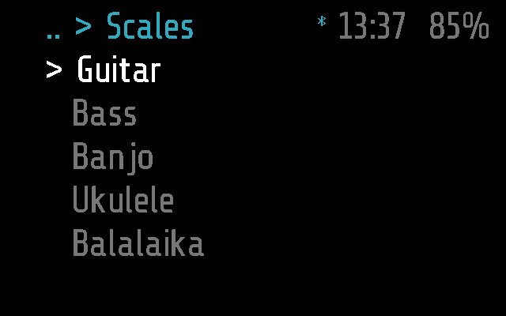
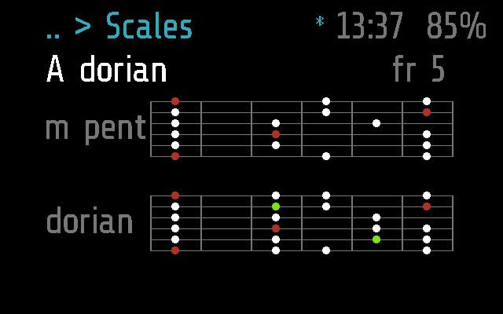
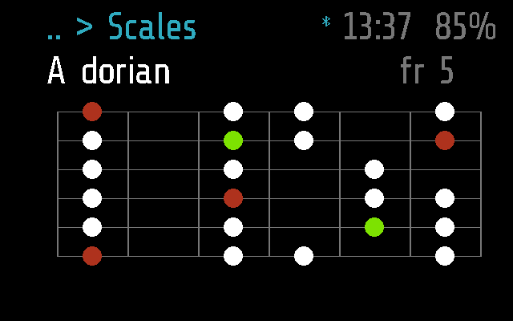
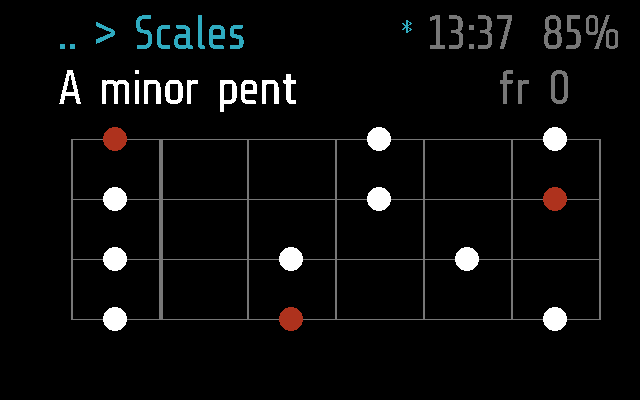

# Scales

Scales on the fretboard of a guitar, bass, banjo, ukulele or balalaika,
two at once: the minor (or major) pentatonic and the scale that grows from
it, so a player sees the safe notes and the colour to improvise with.

Apps > Scales. Frame only. The music side -- the instruments, the boxes,
the colours, the list of scales -- is in
[docs/SCALES.md](../../docs/SCALES.md).

## Screens

On Frame, 2 s after opening: the instruments.



A Dorian, under the A minor pentatonic, the box at fret 5. The root is
red, Dorian's own note (F#, the raised 6th) green
(`test_the_phone_sends_a_mode_drawn_under_its_pentatonic`):



The same with the view set to one scale
(`test_the_single_view_shows_the_mode_alone`):



The ukulele's open box, with a nut after fret 0
(`test_a_box_past_the_last_fret_moves_an_octave_down`):



They are made by [`test_scales.py`](test_scales.py), with
`SHOTS=dir`, as `scales-dorian.png`, `scales-dorian-single.png` and
`scales-ukulele-open.png` ([docs/TESTING.md](../../docs/TESTING.md)).

## How it works

**Two states.** It opens on the list of instruments. Taking one shows the
fretboard: the key and the scale's name on top, `fr N` (the box's lowest
fret) at the right, and the box, six frets wide. The module draws it all
itself with `frame.display.bitmap` (`_M.quiet`: `draw()` is the screen;
the `tick()` text only says when to redraw).

**Input.**

| Glasses | Remote (docs/REMOTE.md) | On the list | On the fretboard |
| --- | --- | --- | --- |
| tilt right / left (`on_roll`) | Right / Left | next / previous instrument | next box up / down the neck, round |
| single tap (`on_tap`) | OK | take the instrument, the first scale | the next scale |
| -- (`on_up_down`) | Down / Up | as a tilt | the next / previous scale |
| double tap (`on_back`) | Back | to the menu | back to the list |

The remote is the phone's Remote tab, a keyboard or a Flipper
([docs/REMOTE.md](../../docs/REMOTE.md); `INPUT` in
[docs/PROTOCOL.md](../../docs/PROTOCOL.md), "Remote").

**Scales come from the phone.** The glasses keep only the scale on screen,
for memory. To change it the module sends `SCALE_GET` `[0x02, n]` (`n`
0-based, round the phone's count), and the phone answers with
`MODULE_CALL` `scales` into `remote(arg)`:

```
g<n> <count> <name>|<short>|<notes>|<flavour>|<base short>|<base notes>
g2 14 dorian|dorian|023579a|9|m pent|0357a
```

Notes are a hex digit each, semitones above the root; `flavour` is the
note drawn green; the base is the pentatonic drawn above it, and empty for
a pentatonic, which is drawn alone. A malformed answer, a count of 0 or
more than 256 is ignored. Taking an instrument asks for scale 0 afresh.
Without the phone there is the minor pentatonic, built in. The phone side
is [`flutter-glaz/lib/services/scales.dart`](../../flutter-glaz/lib/services/scales.dart),
which holds the 14 scales.

**Boxes.** Five a scale, one on each note of the pentatonic (the base, for
a mode) on the instrument's reference string, from the root up. A box that
would run past the instrument's last fret moves an octave down, when there
is an octave below it. Tilting goes round them.

**Settings.** Glaz > Menu > Scales on the phone: `key` (C to B, `A` by
default, an unknown one is A) and `view` (`dual`, two scales, or `single`).
They are read in `start()`, so a change applies the next time Scales opens
([docs/PROTOCOL.md](../../docs/PROTOCOL.md), "Settings").

**Timers.** `mode = 'app'`, `background = false`: it stops when it leaves
the screen, and opens again on the list. Playing, the hands are on the
instrument, so any input -- a tilt too, or a scale from the phone -- keeps it
open: `busy()` holds `APP_TIMEOUT` off for `IDLE_MAX` (600 s) after the last
input, and it closes a minute after that.

**Frame and Halo.** Frame only: `scales.frame.lua` is empty and there is no
Halo part, so the phone neither uploads it to Halo nor lists it there
([docs/DEVICES.md](../../docs/DEVICES.md)). Halo's round 256x256 screen
needs a layout of its own first.

## Files

- [`scales.lua`](scales.lua) -- the module
- [`scales.frame.lua`](scales.frame.lua) -- its part for Frame, empty
- [`../../flutter-glaz/lib/services/scales.dart`](../../flutter-glaz/lib/services/scales.dart)
  -- the scales, and the phone's answer to `SCALE_GET`
- [`test_scales.py`](test_scales.py) -- its tests
