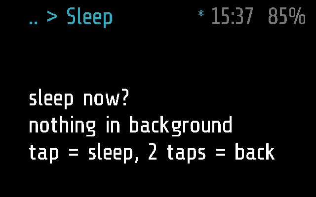
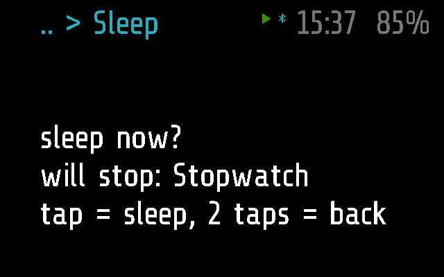
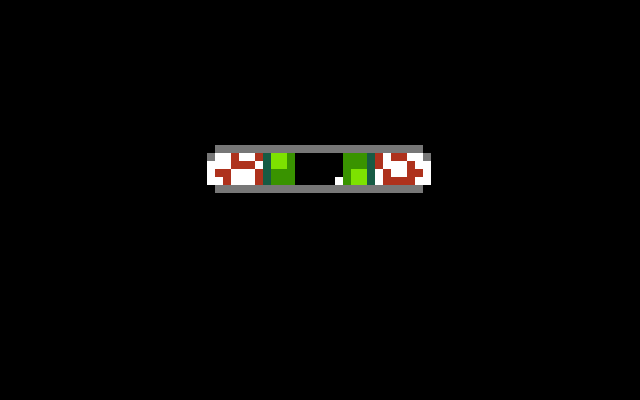
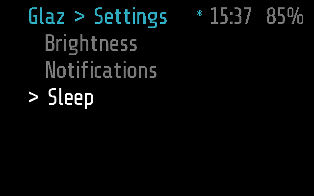

# Sleep

Puts the glasses into deep sleep now, until the next tap. Use it to save
the battery when glaz would not sleep by itself: while the phone is
connected, or while an app runs in the background.

## Screenshots

Frame (Sleep is Frame's only):

With the Stopwatch running in the background, Sleep says it will stop it
(`test_names_the_background_module_it_will_stop` in
[test_sleep.py](../../tests/test_sleep.py)):

After the tap, the eye closes for a second before the screen goes dark
(`test_the_eye_closes_before_the_screen_goes_dark`):

Where it is picked, Glaz > Settings > Sleep
(`test_picked_from_settings_in_the_menu`):

## How it works

Sleep is an `app` module ([PROTOCOL.md, Modules](../../docs/PROTOCOL.md#modules))
that sleeps when it leaves the screen (`background = false`).

- **Why it is needed.** glaz goes into deep sleep by itself only when
  nothing happens for `SLEEP_AFTER` (30 s), no module runs in the
  background and no phone has been connected for `LINK_GRACE` (60 s)
  ([glaz.lua](../../glaz/glaz.lua), the main loop). Sleep skips all three
  conditions.
- **The screen.** Three lines: `sleep now?`, then either
  `nothing in background` or `will stop: <app>`, then
  `tap = sleep, 2 taps = back`. glaz passes `start()` the label of the
  module in the background, so the warning is fresh each time Sleep opens.
- **A single tap** (the arm's or the phone remote's) returns `'sleep'` as
  `on_tap()`'s "done" value. glaz then stops Sleep and, on the next pass of
  its loop, closes everything: the menu, the module in the background
  (which gets its `stop()`), the camera and microphone. The eye closes
  for a second (`glaz/glaz_blink.frame.lua`, `say_goodnight()`), the
  display goes off and the glasses park in `frame.sleep()`. A connected
  phone loses the app until they wake.
- **A double tap** goes back to the Settings menu; nothing sleeps.
- **Tilt** does nothing. Three taps put the glasses to sleep from here as
  from anywhere else.
- **Left alone**, it closes after `APP_TIMEOUT` (60 s) without sleeping.
- **Waking.** A tap wakes the glasses; on Frame waking is a reset, and
  the boot opens the last app that ran before Sleep (its name is kept in
  `last.txt`), or the menu at its root when there was none. Sleep sets
  `resume = false`, so it is never that last app itself: waking does not
  ask again. A background app stopped by Sleep comes back started afresh
  (a stopwatch at `0:00.0`). Before sleeping, glaz puts the tap settings
  back to stock (`WAKE_TAPS`), so a hard Tap tune setting cannot keep the
  glasses from waking ([FIRMWARE.md](../../docs/FIRMWARE.md)). How many
  taps wake them depends on the firmware branch
  ([TESTING.md](../../docs/TESTING.md)).
- **The phone.** It has no `remote()`, so the phone cannot call it
  (`MODULE_CALL`); the phone lists it under Settings
  ([glasses_menu.dart](../../flutter-glaz/lib/glasses_menu.dart)) and can
  open it like any app. It needs no phone to work.

### Frame and Halo

Sleep runs on Frame only. [sleep.frame.lua](sleep.frame.lua) is empty;
there is no Halo part, so the phone neither uploads it to Halo nor lists
it there ([DEVICES.md](../../docs/DEVICES.md)). On Halo three taps still
put the glasses to sleep (`standby()`, [HALO.md](../../docs/HALO.md)).

## Files

- [sleep.lua](sleep.lua) -- the module: the warning and the tap.
- [sleep.frame.lua](sleep.frame.lua) -- Frame's part, empty.
- [../../tests/test_sleep.py](../../tests/test_sleep.py) -- the tests, on
  emulated Frame: the warning, sleeping and waking, the background app
  stopped, the timeout, no Sleep on Halo.
