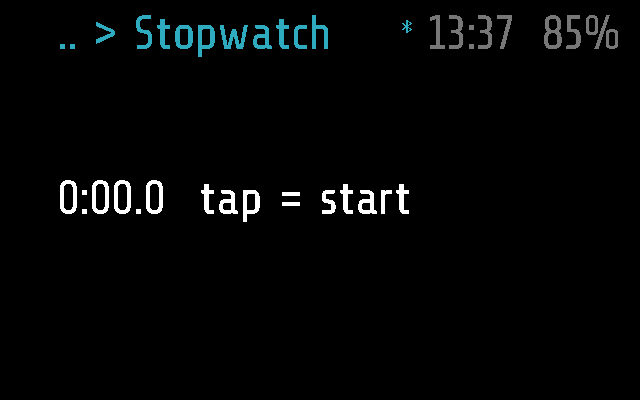
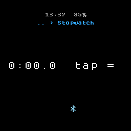
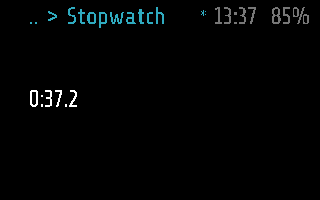
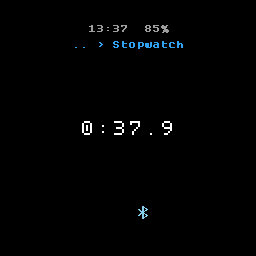

# Stopwatch

A stopwatch on the glasses, to tenths of a second. It keeps counting when
you leave it, so you can go back to the menu or put the screen away and
look again later.

## Screenshots

Frame:

Halo (the round screen cuts the line; the hint reads `tap = ` there):

Running, 37 s after a tap (`test_a_tap_starts_it_and_time_counts` in
[test_stopwatch.py](test_stopwatch.py)), Frame and Halo:

## How it works

Stopwatch is an `app` module that can stay in the background
([PROTOCOL.md, Modules](../../docs/PROTOCOL.md#modules)). The code is
[stopwatch.lua](stopwatch.lua).

- **The screen.** One line, `M:SS.t` (minutes, seconds, tenths), with a
  hint: `tap = start` at zero, `paused, tilt = reset` when paused, nothing
  while it runs.
- **A single tap** starts it, and pauses it while it runs.
- **Tilt** (either way) resets it to zero, only while paused; while it
  runs a tilt does nothing.
- **A double tap** goes back to the menu. A running or paused stopwatch
  stays in the background, and the play icon shows in the top bar; a
  single tap on the blank screen brings it back. One at zero is closed
  for good. The module decides this in `background()`, which glaz asks
  each time it leaves the screen.
- **The time** comes from `frame.time.utc()`: the moment it started and
  the seconds banked by earlier runs, not a count of ticks. So it stays
  exact however rarely it is ticked; in the background glaz ticks it only
  once a second (`BG_TICK_PERIOD`).
- **Timeout.** On screen, glaz closes it after `APP_TIMEOUT` (60 s)
  without a tap; a running or paused stopwatch goes to the background
  then, as with a double tap. Only one module runs in the background at a
  time: another app that goes to the background takes its place and stops
  it.
- **Stopped for good** (`stop()`): by Sleep, three taps (deep sleep) or
  another background app taking its place. The next launch starts from
  zero.
- **The phone.** No settings and no `remote()`. The phone lists it under
  Apps ([glasses_menu.dart](../../flutter-glaz/lib/glasses_menu.dart)),
  can open it, and its remote's taps and tilts work as the arm's
  ([REMOTE.md](../../docs/REMOTE.md)).

### Frame and Halo

Both parts, [stopwatch.frame.lua](stopwatch.frame.lua) and
[stopwatch.halo.lua](stopwatch.halo.lua), are empty: `stopwatch.lua` runs
as it is on both ([DEVICES.md](../../docs/DEVICES.md)). Halo's screen
centres the line and cuts it to the circle's width
([HALO.md](../../docs/HALO.md)), so the longer hints do not fit whole.

## Files

- [stopwatch.lua](stopwatch.lua) -- the module.
- [stopwatch.frame.lua](stopwatch.frame.lua) -- Frame's part, empty.
- [stopwatch.halo.lua](stopwatch.halo.lua) -- Halo's part, empty.
- [test_stopwatch.py](test_stopwatch.py) -- the
  tests, on emulated Frame and Halo: start, pause, reset, the background.
