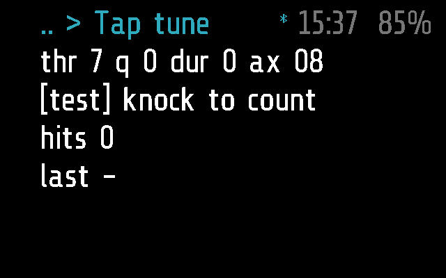
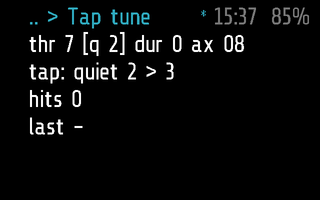
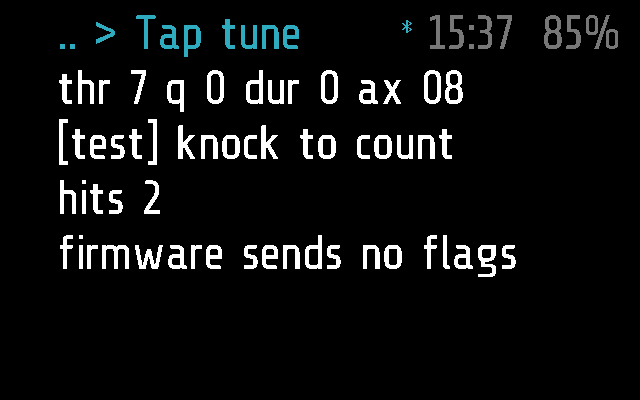

# Tap tune

Tunes how the glasses feel a tap, on the glasses themselves: how hard a
knock must be, how long, which way, and the silence after it. Knock and
watch the counter: one knock should count one hit, not five.

Sensors > Tap tune. Frame only, and only with glaz's firmware, which has
`frame.imu.tap_config`. Calibrating with it is in
[docs/FIRMWARE.md](../../docs/FIRMWARE.md), "Calibrating".

## Screens

On Frame, 2 s after opening: the chip's settings, the cursor on test.

The cursor on `quiet`, after two taps stepped it from 0 to 2
(`test_quiet_and_duration_step_on_their_own`):

On test, two taps counted (`test_on_test_a_tap_counts_and_changes_nothing`).
The emulator's taps carry no status byte, hence the last row:

They are made by [`tests/test_taptune.py`](../../tests/test_taptune.py),
with `SHOTS=dir`, as `taptune-quiet.png` and `taptune-hits.png`
([docs/TESTING.md](../../docs/TESTING.md)).

## How it works

**The screen**, four rows (`_M.rows = 4`):

1. the settings, the one under the cursor in brackets:
   `thr 7 q 0 dur 0 ax 08`
2. what a tap does here: `tap: quiet 2 > 3`, or on test
   `[test] knock to count`
3. `hits N`, the raw hits since the last change
4. the last knock's status byte, raw and decoded: `last 0x08 Y-`; `last -`
   before a knock, `firmware sends no flags` when the firmware passes none

| Setting | Values it steps through | What it does (MC6470) |
| --- | --- | --- |
| `threshold` (`thr`) | 3 5 7 10 15 20 30 50 | how hard a knock must be, all three axes |
| `quiet` (`q`) | 0 1 2 3 4 6 8 12 15 | silence after a tap: the anti-bounce control |
| `duration` (`dur`) | 0 1 2 3 4 6 8 12 15 | the shortest impulse taken |
| `axes` (`ax`) | 08, 3F | which way a knock must push: -Y only, or all six |

**Input.**

- A tilt (`on_roll`), or the remote's Left and Right, moves the cursor over
  the four settings and test, round.
- A single tap (`on_tap`) on a setting steps it to its next value, round
  from the last, and programs the chip at once (`frame.imu.tap_config`).
  The count and the last knock start again. A value not on the list steps
  to the first; a threshold that differs between axes shows `thr ?`.
- On test a tap changes nothing. Every raw hit reaches the module through
  `on_hit(n, flags)`, bounces included, and is counted; the module never
  takes `frame.imu.tap_callback` over. The remote's OK is no knock: it
  counts nothing. Nor do hits while the phone's Remote tab or a keyboard
  holds the gestures (`HANDS_OFF`, [docs/PROTOCOL.md](../../docs/PROTOCOL.md),
  "Remote").
- A double tap leaves, as any app.

**Closing.** `mode = 'app'`, not in the background: it stops when it
leaves the screen, and after `APP_TIMEOUT` (60 s) without input; knocks
count as input. When it stops -- a double tap, the timeout, sleep -- `axes`
goes back to what it was when it opened. The other settings stay until the
glasses restart: nothing is saved. Before deep sleep the app and the
firmware put back the stock tap settings, so the glasses still wake
([docs/FIRMWARE.md](../../docs/FIRMWARE.md)).

**Stock firmware.** Without `frame.imu.tap_config` it shows
`needs the glaz firmware`, and taps and tilts do nothing.

It asks nothing of the phone, and has no settings there.

**Frame and Halo.** Frame only: `taptune.frame.lua` is empty and there is
no Halo part, so the phone neither uploads it to Halo nor lists it there
([docs/DEVICES.md](../../docs/DEVICES.md)).

## Files

- [`taptune.lua`](taptune.lua) -- the module
- [`taptune.frame.lua`](taptune.frame.lua) -- its part for Frame, empty
- [`../../tests/test_taptune.py`](../../tests/test_taptune.py) -- its tests,
  on the emulator and, for `tap_config`'s per-axis thresholds, the module
  alone in Lua
