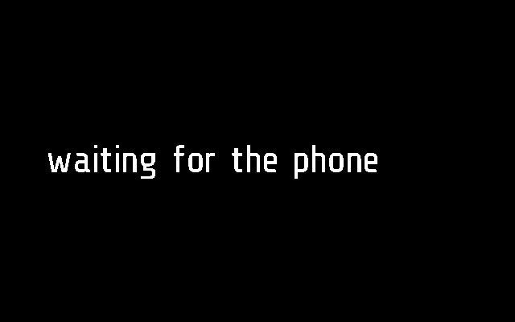
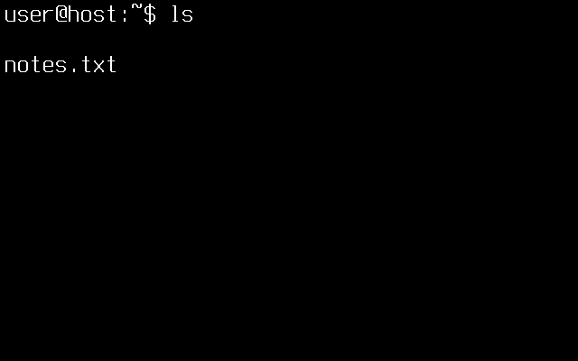
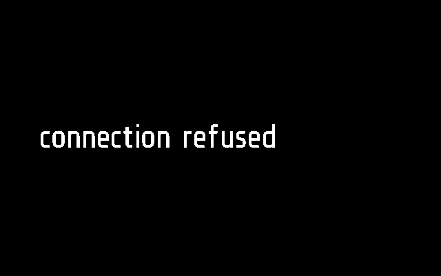

# Terminal

A terminal on the glasses: a shell on a computer of yours, over SSH from
the phone. A keyboard on the phone (a Bluetooth one, say) types into it;
the glasses show its screen, 45 columns by 12 rows.

Apps > Terminal. Frame only, with the glaz firmware.

## Screens

On Frame, 2 s after opening, before the phone has answered:

A frame from the phone, two rows of a shell
(`test_a_frame_is_drawn_row_by_row_and_taken`):

No screen to show, and the phone's words why
(`test_a_status_from_the_phone_replaces_the_screen`):

Made by [`tests/test_term.py`](../../tests/test_term.py) with `SHOTS=dir`,
as `term.png` and `term-status.png`
([docs/TESTING.md](../../docs/TESTING.md)). The same tests also save
`term-full.png` (all 12 rows full), `term-waiting.png`, `term-no-phone.png`
and `term-no-firmware.png`.

## How it works

The module only draws. The phone holds the SSH session and the terminal's
screen (xterm's model, 45x12 cells) and sends the glasses the rows that
changed. The phone side is
[`flutter-glaz/lib/services/term.dart`](../../flutter-glaz/lib/services/term.dart);
the whole protocol is in [docs/PROTOCOL.md](../../docs/PROTOCOL.md),
"Terminal".

**Asking the phone.** From its first `tick()` (not `start()`) the module
sends `TERM` `[0x0C, 1, 45, 12]`, and again every 3 s (`ASK_AGAIN`) until
the phone says anything. It sends `[0x0C, 0]` when it stops, if it had
asked. With no phone connected it shows `no phone` and drops what it had.

**What the phone sends.** `MODULE_CALL` `term`, into `remote(arg)`:

| Argument | Means |
| --- | --- |
| `'f' seq flags mask rows` | a frame: `seq` one byte; `flags` bit 0 set when the wearer typed since the last; `mask` 16 bits, a bit a row, row 1 the high bit; then for each row whose bit is set `n`, `n` characters and `n` attribute bytes, a byte a cell, as `frame.display.mono`'s `attrs` |
| `'s' text` | no screen, and why (connecting, no host, an error); the rows are cleared and the text shown |

Each frame is answered with `TERM` `[0x0C, 2, seq]`; the phone sends the
next frame only after that, one at a time, as for Flipper. A row of
blanks with no background colour is not kept.

**What it shows.** `_M.fullscreen`: no top bar. `draw()` draws each row
with one `frame.display.mono` call, 14x28 px cells, 630x336 from (6, 3),
in the visible 640x340. `mono` is in the glaz firmware only; without it
the screen says `needs the glaz firmware`. Before the first frame it shows
`waiting for the phone`, or the phone's status words.

**Input.** The keys go to the phone, not the glasses: a keyboard on the
phone types into the shell, also with the app in the background
(`KeyRemoteService`; [docs/REMOTE.md](../../docs/REMOTE.md)).
Ctrl+Alt+Esc closes the terminal, as a double tap does. A tap on the
glasses only keeps the module open.

**Staying open.** Each frame from the phone counts as activity for
`glaz.lua` (`MODULE_CALL` to the module on screen), so the app's minute
without a gesture (`APP_TIMEOUT` in [`glaz/glaz.lua`](../../glaz/glaz.lua))
does not close it while the shell draws. The module has its own limit
instead: 10 minutes (`IDLE`) without a tap or a typed key (flag bit 0)
closes it with `no key for a while`, since programs such as `top` redraw by
themselves and would keep the display lit and the glasses awake for good.
It is kind `app` with no `_M.background`: it stops when it leaves the
screen and keeps nothing; the phone keeps the shell for 15 minutes, so
opening it again goes on where it was.

**Settings.** None on the glasses. Hosts and keys are on the phone, Menu >
Terminal, its own page; keys and passwords are kept in Android's keystore.

**Frame and Halo.** `term.lua` uses Frame's API as it is (and the glaz
firmware's `mono`), so the app has only a Frame part, empty; the phone
neither uploads it to Halo nor lists it there
([docs/DEVICES.md](../../docs/DEVICES.md)).

## Files

- [`term.lua`](term.lua) -- the app
- [`term.frame.lua`](term.frame.lua) -- its part for Frame: nothing of its
  own
- [`tests/test_term.py`](../../tests/test_term.py) -- its tests, on
  emulated Frame
