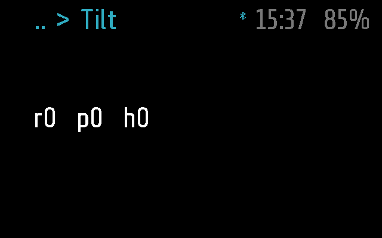
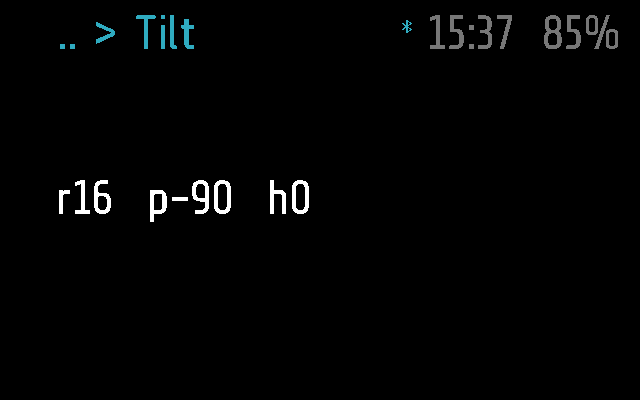

# Tilt

The head's orientation, live: roll, pitch and heading in whole degrees.
Useful for tuning the menu's head-tilt navigation, whose thresholds come
from these numbers.

Sensors > Tilt. Frame only.

## Screens

On Frame, 2 s after opening, the emulated head level:

The head turned: roll 16, pitch -90 (`test_follows_the_head_live`):

Made by [`tests/test_tilt.py`](../../tests/test_tilt.py), with `SHOTS=dir`,
as `tilt-turned.png` ([docs/TESTING.md](../../docs/TESTING.md)).

## How it works

`tick()` reads `frame.imu.direction()` and returns
`r<roll>  p<pitch>  h<heading>`. The app calls it every 0.25 s
(`APP_TICK_PERIOD`) and redraws when the text changes. Degrees are rounded
half up with `math.floor(x + 0.5)`, not `'%.0f'`, which prints -0.4 as
`-0`: a level head would flicker between `r0` and `r-0`.

On the glasses the resting pitch is around -35, not 0, and the heading
reads 0 on firmware v25.080.0838 (the comment in `tilt.lua`).

**Input.** None of its own. A tilt only changes the numbers: there is no
`on_roll`, so it does not leave. Nor do the remote's arrows. A single tap
keeps it open; a double tap leaves, back to Sensors. The phone cannot call
it (no `remote()`), and it asks nothing of the phone.

**Timers.** `mode = 'app'`, `background = false`: it keeps refreshing while
on screen, stops as soon as it leaves, and closes after `APP_TIMEOUT`
(60 s) without a tap ([docs/PROTOCOL.md](../../docs/PROTOCOL.md),
"Modules"). A notification pops up over it, and it carries on underneath.

**Frame and Halo.** Frame only: `tilt.frame.lua` is empty and there is no
Halo part, so the phone neither uploads it to Halo nor lists it there
([docs/DEVICES.md](../../docs/DEVICES.md)).

## Files

- [`tilt.lua`](tilt.lua) -- the module
- [`tilt.frame.lua`](tilt.frame.lua) -- its part for Frame, empty
- [`../../tests/test_tilt.py`](../../tests/test_tilt.py) -- its tests
