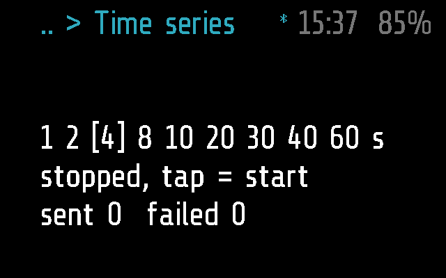
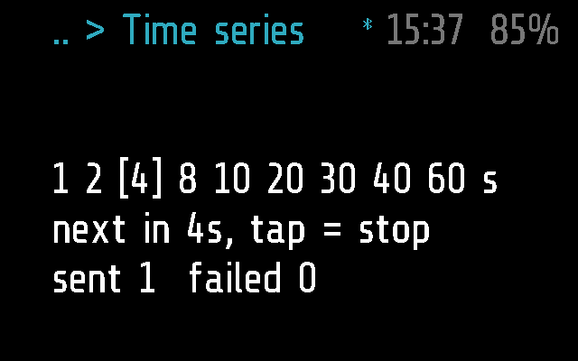
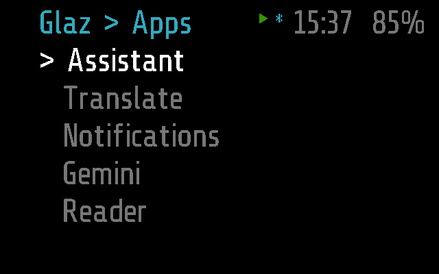

# Time series

Takes a photo every 1 to 60 seconds and sends each one to the phone,
which keeps a series in a folder of its own. Use it for a time-lapse, or
to keep a record of a walk or a day's work. It goes on shooting when you
leave it.

## Screenshots

Frame (Time series is Frame's only):

Shooting at 4 s, after the first photo
(`test_a_tap_starts_after_the_exposure_settles` in
[test_timeseries.py](../../tests/test_timeseries.py)):

Left while shooting: the menu, with the play icon in the top bar for the
series running in the background
(`test_the_background_icon_shows_while_it_runs`):

## How it works

Time series is an `app` module that stays in the background while it
shoots and sleeps while stopped
([PROTOCOL.md, Modules](../../docs/PROTOCOL.md#modules)). The code is
[timeseries.lua](timeseries.lua).

- **The screen.** Three lines: the interval scale
  `1 2 [4] 8 10 20 30 40 60 s`, brackets on the choice; the status,
  `stopped, tap = start`, `next in Ns, tap = stop` or `no host, waiting`;
  and `sent N  failed N` for the current series.
- **Tilt** right or left moves to the next or previous interval; at an
  end of the scale it does nothing. It works while shooting too: a
  shorter interval brings the next shot forward, a longer one counts from
  the next shot.
- **A single tap** starts a series, and stops it while it runs. A start
  zeroes the counts, takes the phone's interval if it has one, wakes the
  camera and waits 1.5 s (`WARMUP`) for the auto exposure before the
  first shot. A stop puts the camera back to sleep.
- **A double tap** goes back. A running series goes on in the background,
  with the play icon in the top bar; a stopped one is closed. On screen,
  `APP_TIMEOUT` (60 s without input) sends a running series to the
  background as well, and closes a stopped one. Being in the background
  keeps the glasses from deep sleep, so a series is never frozen.
- **Shooting.** Each `tick()` runs the camera's auto exposure; when the
  next shot is due and the phone is connected, the module sends
  `PHOTO_FROM` `[0x1A, series]`, then the photo with camera.min's
  `capture_and_send()`, as Camera does: `0x07` chunks and a final `0x08`
  ([PROTOCOL.md, Photos](../../docs/PROTOCOL.md#photos)). A capture blocks
  the loop for about 1-3 s, so at 1-2 s the transfer sets the real rate:
  shots that fall behind are dropped, not queued. In the background glaz
  ticks it once a second (`BG_TICK_PERIOD`), so shots land on whole
  seconds there.
- **No phone.** Nothing is shot; the status says `no host, waiting`, and
  the series goes on when the link comes back.
- **A failed shot** is counted, and the camera is powered on again for
  the next one (glaz or the host's break may have powered it down).
- **The series number**, 1 to 255, comes from the clock at the start, not
  from a counter, so a series started after the module was reloaded does
  not run into the previous one on the phone.
- **Stopped for good** (`stop()`): by Sleep, three taps, a new menu or
  the break from the phone, or another app taking the background. It
  opens again at 4 s with nothing counted.

### The phone

- **Saving.** The phone rotates each photo upright and saves a series in
  `photos/<date>/<date time of the start>/`; on Android that is
  `Pictures/Glaz` ([PROTOCOL.md, Photos](../../docs/PROTOCOL.md#photos),
  [photos.dart](../../flutter-glaz/lib/services/photos.dart)).
- **Settings**, Glaz > Menu > Time series
  ([glasses_menu.dart](../../flutter-glaz/lib/glasses_menu.dart);
  [PROTOCOL.md, Settings](../../docs/PROTOCOL.md#settings)):
  - `interval`, 1 to 60 s, default 4: where a new series starts. The
    phone always sends it, so with a phone a tilt before the start is
    replaced by it; a value off the scale is ignored.
  - `resolution`, 256, 512 or 720 px, square, default 512, and
    `quality`, Very low to Very high, default Medium: the same choices as
    Camera's. Read at each shot, so a change applies from the next one;
    a size the camera cannot take (odd, below 100 or above 720) falls
    back to 512, an unknown quality to Medium.
- The phone's remote taps and tilts as the arm does
  ([REMOTE.md](../../docs/REMOTE.md)). It has no `remote()` for
  `MODULE_CALL`.

### Frame and Halo

Time series runs on Frame only. [timeseries.frame.lua](timeseries.frame.lua)
is empty; there is no Halo part, so the phone neither uploads it to Halo
nor lists it there ([DEVICES.md](../../docs/DEVICES.md)).

## Files

- [timeseries.lua](timeseries.lua) -- the module.
- [timeseries.frame.lua](timeseries.frame.lua) -- Frame's part, empty.
- [../../tests/test_timeseries.py](../../tests/test_timeseries.py) -- the
  tests, on emulated Frame: the scale, the shots and their rhythm, the
  background, no phone, the phone's settings, the break.
