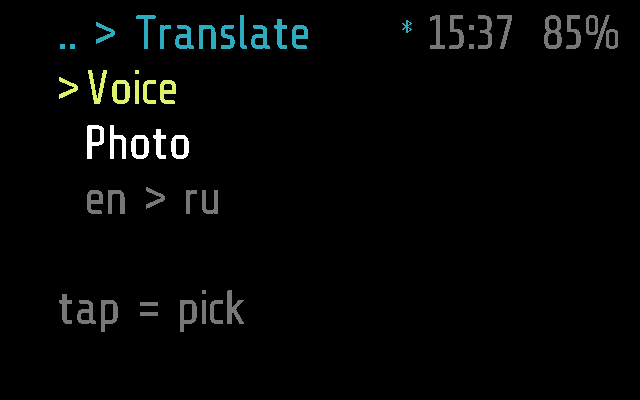
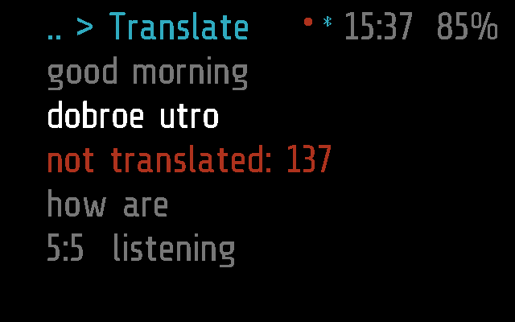
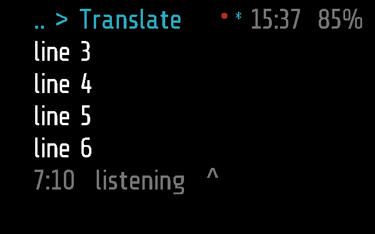
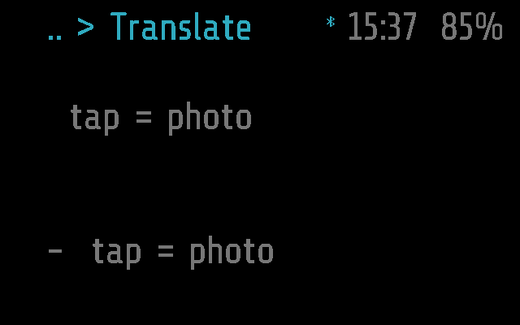

# Translate

Shows, translated, what the other person says, or the text on a photo
the glasses take. The phone does the hearing, reading and translating;
the glasses show the log.

Frame only: the app has no Halo part, so the phone neither uploads it to
Halo nor lists it there ([DEVICES.md](../../docs/DEVICES.md)).

## Screenshots

Frame, 2 s after opening (`python scripts/screenshots.py --readme`): the
mode to pick, and the language pair.

Voice: a source line (grey), its translation (white), an error (red)
and a sentence still being heard; the red dot in the top bar is the
microphone (`test_the_log_is_shown_in_its_colours`):

Scrolled back a screen: `^` in the status row, `7:10` the last line on
screen of all there are (`test_a_tilt_left_scrolls_back_a_screen`):

Photo, before the first photo
(`test_photo_asks_for_the_tail_and_does_not_listen`):

The tests are in [tests/test_translate.py](../../tests/test_translate.py);
`SHOTS=<dir> pytest tests/test_translate.py` saves these screens
([TESTING.md](../../docs/TESTING.md)).

## How it works

A sleeping `app` module: it stops when it leaves the screen. It draws
the screen itself (`_M.quiet`, `draw()`): four rows of the log and a
status row.

On entry it asks **Voice** or **Photo**, the cursor on the one picked
last (kept on the glasses as a pref, `_M.host.pref('mode')`). Nothing
is sent to the phone until a mode is picked.

| Input | Chooser | Voice | Photo |
| --- | --- | --- | --- |
| tilt right / left | the next / previous mode | a screen down / up; down at the end follows again | the same |
| tap | pick | pause / listen again | take a photo to translate |
| double tap | back to the menu | back to the chooser: the sound ends, the session closes | back to the chooser: the camera off, the session closes |

**The log.** The phone keeps it and cuts it into lines that fit the
screen. Colours: translation white, the original grey (only with
Original text on), a line still being heard grey, a separator such as
`en > ru 14:07` sky blue, an error red. The status row is `<last line
on screen>:<total>` and `listening`, `paused`, `tap = photo` or the
phone's status text (`downloading en>ru..`, `Translate is off on
phone`); `^` when not following, `lost N K` for sound the link dropped.
On entry the view follows the end of the log; a tilt up stops that.

**Voice.** The microphone streams as Recorder's: `REC_START` with a
fourth byte `2` (for Translate), `AUDIO` packets, `AUDIO_END` on a
pause. 8 kHz, 16-bit unless the `bits` setting says 8. While listening
`_M.rec` is true (the red dot) and `busy()` keeps `APP_TIMEOUT` from
closing it; it pauses by itself after 30 minutes. One direction only:
the other speaker, into the wearer's language.

**Photo.** A tap takes a photo as the phone's remote does
([glaz_photo.frame.lua](../../glaz/glaz_photo.frame.lua)): 720 px,
quality HIGH, with `PHOTO_FROM 255`, so the phone reads its text and
translates it into the same log instead of keeping the photo. ML Kit
reads Latin, Chinese, Devanagari, Japanese and Korean, not Cyrillic.
The camera stays on until Photo is left.

**What it asks of the phone.** `TRANSLATE` (`0x0F`, `>BBBI2B`: op, sess,
from, count): `0` the wearer left, `1` lines from `from` (stops
following), `2` the last `count` lines, and follow. The phone answers,
and pushes while the glasses follow, with `MODULE_CALL` `translate`:
`w:` lines, `n:` the log grew, `s:` the status text, `x:` the status
and the phone no longer hears (the microphone stops). The glasses ask
again after 5 s without an answer, and at once when the link comes back
after a drop, listening again if they were. Details in
[PROTOCOL.md, Translate](../../docs/PROTOCOL.md#translate).

The phone ([translate.dart](../../flutter-glaz/lib/services/translate.dart))
recognises speech and translates with ML Kit on the phone; the models
download when first needed, then nothing goes to the Internet.

**Settings** (Glaz > Menu > Translate, on the phone): `from` the
speaker's language (default `en`), `to` the wearer's (`ru`), `bits` 8 or
16 (`16`), `source` the original text shown (`off`). Translate is also
a service of its own on the phone, on by default.

## Files

- [translate.lua](translate.lua) -- the app
- [translate.frame.lua](translate.frame.lua) -- its part for Frame,
  empty
- [../../tests/test_translate.py](../../tests/test_translate.py) -- its
  tests
- [../../flutter-glaz/lib/services/translate.dart](../../flutter-glaz/lib/services/translate.dart)
  -- the phone side
