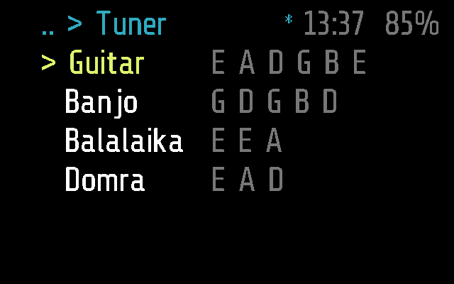
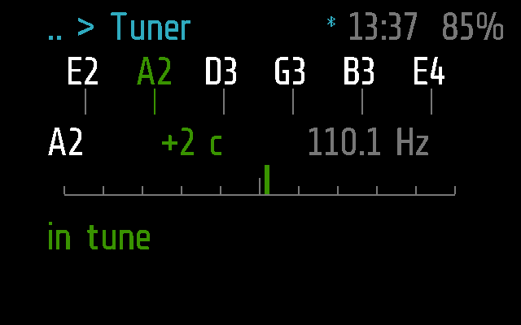
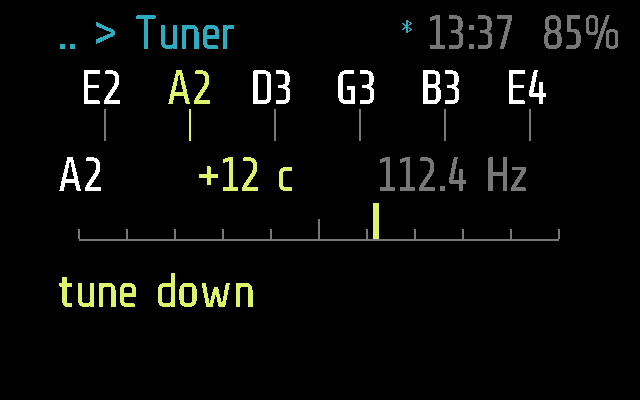
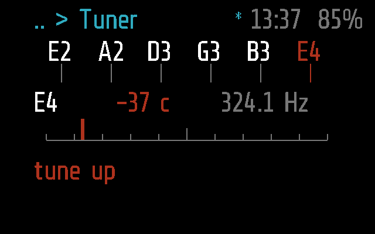

# Tuner

A tuner for string instruments: guitar, banjo, balalaika, domra, ukulele,
bass and violin. Play a string; the glasses show which string it is
nearest, how far off in cents, and whether to tune up or down.

Apps > Tuner. Frame only. The phone does the listening.

## Screens

On Frame, 2 s after opening: the instruments, each with its tuning.

A guitar's A string 2 cents sharp: in tune, green
(`test_a_note_in_tune_is_green`):

12 cents sharp: yellow, `tune down`
(`test_a_little_sharp_is_yellow_and_says_tune_down`):

The high E 37 cents flat: red, `tune up`
(`test_far_flat_is_red_and_says_tune_up`):

They are made by [`test_tuner.py`](test_tuner.py), with
`SHOTS=dir`, as `tuner-in-tune.png`, `tuner-sharp.png` and
`tuner-flat.png` ([docs/TESTING.md](../../docs/TESTING.md)).

## How it works

The phone side, the messages and the pitch finding are in
[docs/PROTOCOL.md](../../docs/PROTOCOL.md), "Tuner".

**Two states.**

- **The list**: the instruments, four rows at a time, the cursor yellow,
  each with its open strings beside it. It opens at the instrument tuned
  last, kept on the glasses as the pref `instrument` (`_M.host.pref`),
  since the module's locals go when it stops.
- **Tuning**: the open strings as players name them (a guitar's
  `E2 A2 D3 G3 B3 E4`, a banjo's short string `G4` first), the one nearest
  the note heard lit; under them the note heard, its cents from that
  string and its Hz; a scale of -50 to +50 cents with a needle; and a
  hint: `play a string`, `tune up`, `tune down`, `in tune`. Green within
  5 cents, yellow within 20, red beyond. When the phone hears nothing any
  more the last note stays, grey. Words from the phone (`allow the
  microphone`) replace the hint, in yellow.

The module draws both itself (`_M.quiet`: `draw()` is the screen; the
`tick()` text only says when to redraw).

**Input.** On the list a tilt (`on_roll`), or the remote's arrows, moves
the cursor round; a tap (`on_tap`) or OK tunes that instrument. While
tuning, tilts and taps do nothing; a double tap (`on_back`) goes back to the
list and stops the listening, and on the list leaves the app.

**What it asks of the phone.** With a tuning on screen it sends `TUNER`
`[0x03, 1, mic]`, and again every 3 s until the phone answers;
`[0x03, 0]` when it goes back to the list or stops. The phone answers with
`MODULE_CALL` `tuner`, into `remote(arg)`:

| Argument | Means |
| --- | --- |
| `p<pitch> <hz>` | a note: `pitch` in hundredths of a semitone, MIDI numbering (`4512`: A2 and 12 cents), `hz` in tenths |
| `p` | nothing heard any more; a malformed note counts as this |
| `s<text>` | no note, and why; an empty text only says the phone is listening |

The glasses work out the nearest string and the cents: the instruments and
their tunings live only in the module. The phone side is
[`flutter-glaz/lib/services/tuner.dart`](../../flutter-glaz/lib/services/tuner.dart).
Without Bluetooth the module shows `no phone`, and asks again when the link
is back.

**Setting: the microphone.** Glaz > Menu > Tuner, `mic`:

- `phone` (the default): the phone's own. glaz must be open on the phone,
  as Android gives an app in the background silence.
- `glasses`: the module streams the glasses' microphone, 16 bit at 8 kHz,
  as Recorder does: `REC_START` with `for` = 3, then `AUDIO` packets of
  whole samples, drained every 0.1 s (`_M.period`), and `AUDIO_END` when it
  stops. If the microphone does not start, it shows `no microphone`.

**Timers.** `mode = 'app'`, not in the background: it stops when it leaves
the screen, and the listening with it. Tuning takes no taps, so notes keep
it open: `busy()` holds `APP_TIMEOUT` (60 s) off for 30 s (`AWAKE`) after
the last note, and it closes a minute after that. Without notes it closes
after `APP_TIMEOUT`.

**Frame and Halo.** Frame only: `tuner.frame.lua` is empty and there is no
Halo part, so the phone neither uploads it to Halo nor lists it there
([docs/DEVICES.md](../../docs/DEVICES.md)).

## Files

- [`tuner.lua`](tuner.lua) -- the module
- [`tuner.frame.lua`](tuner.frame.lua) -- its part for Frame, empty
- [`../../flutter-glaz/lib/services/tuner.dart`](../../flutter-glaz/lib/services/tuner.dart)
  -- the phone's side: the microphone and the pitch (YIN)
- [`test_tuner.py`](test_tuner.py) -- its tests
