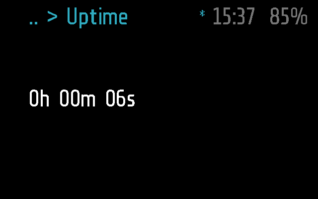
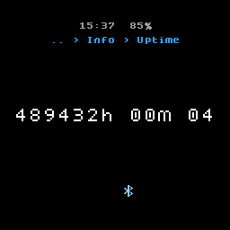
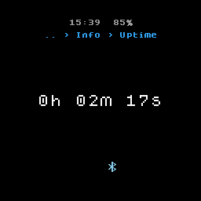
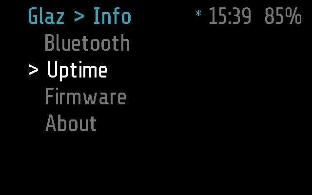

# Uptime

How long the glasses have been on, as hours, minutes and seconds. Use it
to see when they last started: after a power-on, a deep sleep or a crash.

## Screenshots

Frame:

Halo:

The Halo shot above is from Brilliant Labs' Halo emulator, whose
`frame.time.utc()` is a wall clock, so it shows the hours since 1970, cut
by the round screen. The tests set the clock to 137 s first, as if just
powered on (`test_shows_the_uptime` in
[test_uptime.py](../../tests/test_uptime.py)):

Where it is picked, Glaz > Info > Uptime (`test_picked_in_info`):

## How it works

Uptime is an `info` module, the default kind
([PROTOCOL.md, Modules](../../docs/PROTOCOL.md#modules)): `run()` returns
its text once, and the app clears the screen after `INFO_TIMEOUT`, 5 s.
The code is [uptime.lua](uptime.lua), a few lines.

- **The value.** `frame.time.utc()`, cut to whole seconds, as
  `Hh MMm SSs`: minutes and hours carried over, no days. glaz never sets
  this clock (the time in the top bar comes from the phone), so on Frame
  it counts from power-on, and the phone's clock changes nothing. Waking
  from deep sleep is a reset on Frame, so it starts again from zero.
- **It does not count on screen.** The value is taken when it opens; a
  tap on the blank screen after it went brings it back, counted again.
- **Opening it.** Glaz > Info > Uptime, a tap on the blank screen when it
  was the last app, or the phone's `APP_OPEN` (the Menu tab). An argument
  from the phone is ignored.
- **Input.** A single tap, a tilt and Halo's button change nothing and do
  not keep it on screen longer. A double tap (the arm's or the remote's
  Back) goes back to the Info menu, the remote's Menu button opens the
  menu, three taps put the glasses to sleep
  ([PROTOCOL.md, States](../../docs/PROTOCOL.md#states)).
- **Background.** None: it stops when it leaves the screen.
- **The phone.** Not needed: it works with no phone connected. It has no
  `remote()`, so the phone cannot call it (`MODULE_CALL`); the phone lists
  it under Info ([glasses_menu.dart](../../flutter-glaz/lib/glasses_menu.dart)).

### Frame and Halo

Both parts, [uptime.frame.lua](uptime.frame.lua) and
[uptime.halo.lua](uptime.halo.lua), are empty: `uptime.lua` runs as it is
on both ([DEVICES.md](../../docs/DEVICES.md)). Halo's screen centres the
line and cuts it to the circle's width ([HALO.md](../../docs/HALO.md)).

## Files

- [uptime.lua](uptime.lua) -- the module.
- [uptime.frame.lua](uptime.frame.lua) -- Frame's part, empty.
- [uptime.halo.lua](uptime.halo.lua) -- Halo's part, empty.
- [../../tests/test_uptime.py](../../tests/test_uptime.py) -- the tests, on
  emulated Frame and Halo: the format, the timeout, the inputs, no phone,
  starting from zero after sleep.
