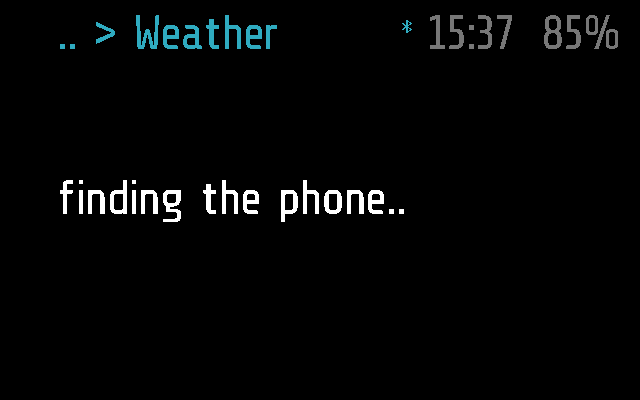
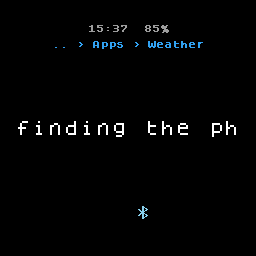
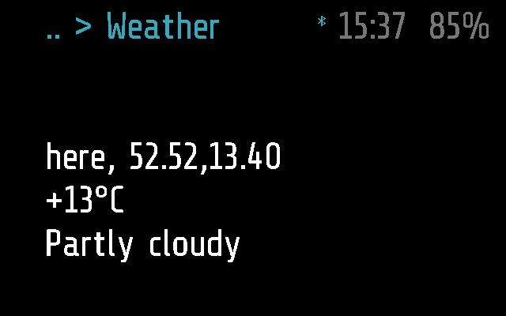
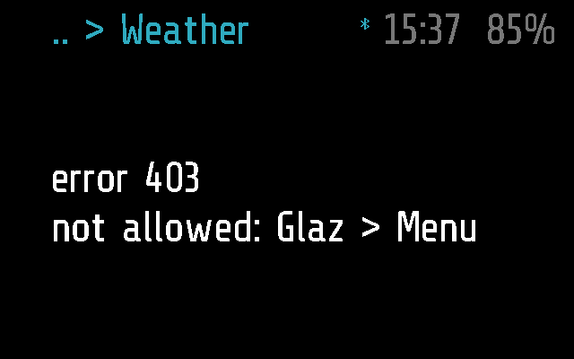
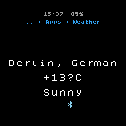

# Weather

The weather where you are, or in a city you set on the phone: the place,
the temperature and the sky, from [wttr.in](https://wttr.in). The phone
fetches it; the glasses have no Internet of their own.

## Screenshots

Frame, 2 s after opening, while it asks the phone where it is:

Halo, the same (the round screen cuts the line):

The answer for the phone's position, named by its coordinates
(`test_the_weather_there_is_shown_by_its_numbers` in
[test_weather.py](../../tests/test_weather.py)):

Not allowed the Internet on the phone
(`test_not_allowed_the_internet_it_says_so`):

Halo with a city set, Berlin, Germany
(`test_a_city_and_country_set_on_the_phone_win`): the line is cut to the
circle, and the degree sign, which Halo's font lacks, is a `?`:

## How it works

Weather is an `app` module that sleeps when it leaves the screen
(`background = false`; [PROTOCOL.md, Modules](../../docs/PROTOCOL.md#modules)).
It is the example of a module that uses the Internet through the phone,
with `_M.host` from [glaz.lua](../../glaz/glaz.lua). The code is
[weather.lua](weather.lua).

- **Where.** On each start and each tap:
  1. A city set on the phone wins, sent as `City,Country` (or the city
     alone).
  2. With none set, it asks the phone where it is (`_M.host.locate()`,
     [PROTOCOL.md, Location](../../docs/PROTOCOL.md#location)) and shows
     `finding the phone..`. A fix gives `lat,lon`, two decimals.
  3. Refused, no fix or a timeout: no place, and wttr.in guesses from
     the phone's Internet address.
- **The request.** `GET https://wttr.in/<place>?format=%l|%t|%C`
  (`_M.host.http`, [PROTOCOL.md, Internet](../../docs/PROTOCOL.md#internet));
  anything in the place but letters, digits and `,.-` is percent-encoded.
  The screen shows `asking the phone..` until `_M.host.result()` has the
  answer.
- **The answer**, `location|temperature|conditions`, is shown as three
  lines, each cut to 26 characters (`..` at the end; counted with
  `utf8.len`, so Cyrillic is cut by characters, not bytes). For a
  position wttr.in names the place by its numbers, so the first line is
  `here, <lat>,<lon>`. An answer of another shape is shown as one line.
- **Errors.** Any status but 200 shows `error <status>` and the body:
  `403 not allowed: Glaz > Menu` when the module has no Internet
  permission or the phone's network service is off; `0` and the error
  when the request got no answer (the phone gives up after 15 s, the
  glasses after `NET_TIMEOUT`, 20 s). Without a phone connected nothing
  is asked: `_M.host.http` fails at once and the screen says
  `no: no phone`; the next tap in range asks again.
- **A single tap** (the arm's or the phone remote's) fetches again, from
  the start: a new position if no city is set. What was still on its way
  from before is forgotten, so an old answer never covers the new one.
- **A double tap** goes back to the menu; nothing stays in the
  background, and its requests are dropped. Tilt does nothing. Without a
  tap it closes after `APP_TIMEOUT`, 60 s.

### The phone

Glaz > Menu > Weather ([glasses_menu.dart](../../flutter-glaz/lib/glasses_menu.dart)):

- **Internet** access for this module: without it every fetch is a 403.
- **Location** access, optional: with it and no city set, the weather is
  for the phone's position; the Location service must be on in Services
  too. Without it, wttr.in guesses from the Internet address.
- **City** and **Country**, free text, empty by default
  ([PROTOCOL.md, Settings](../../docs/PROTOCOL.md#settings)). Read at
  each fetch, so a change applies from the next tap. A country alone is
  not used.

The phone side is
[network.dart](../../flutter-glaz/lib/services/network.dart) (the request,
the 403, a body cut to 4 KB) and
[location.dart](../../flutter-glaz/lib/services/location.dart) (the fix).

### Frame and Halo

Both parts, [weather.frame.lua](weather.frame.lua) and
[weather.halo.lua](weather.halo.lua), are empty: `weather.lua` runs as it
is on both ([DEVICES.md](../../docs/DEVICES.md)). The difference is in
the screen: Frame's firmware font (our build, v26.292 and later) has
Latin-1, so `°C` shows as it is; Halo's screen folds text to printable
ASCII, so it shows `?C`, and cuts each line to the circle's width, 13 or
14 characters in the middle rows ([HALO.md](../../docs/HALO.md)).

## Files

- [weather.lua](weather.lua) -- the module.
- [weather.frame.lua](weather.frame.lua) -- Frame's part, empty.
- [weather.halo.lua](weather.halo.lua) -- Halo's part, empty.
- [../../tests/test_weather.py](../../tests/test_weather.py) -- the tests,
  on emulated Frame and Halo: the place, the position, the answer and its
  lines, errors, taps, no phone.
