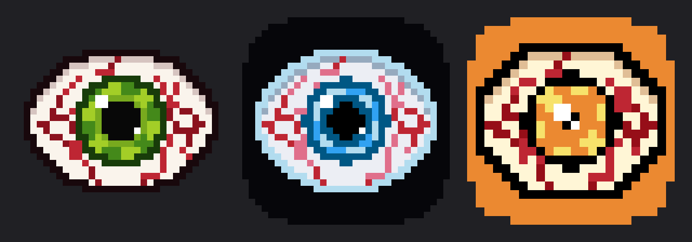

# glaz companion

The phone side of glaz. The menu and the apps live on the glasses
(`../frame_app.lua`); this app is the host that talks to them over
Bluetooth -- the role `../host_test.py` plays on a laptop today.

Tabs:

- **Glasses** -- connect over Bluetooth; battery and firmware; Upload
  (`main.lua` and the apps switched on in Menu), Restart, Firmware (install
  another version over the air); the gestures that drive the glasses
- **Photos** -- photos from Camera and Time series, by date; a series is a
  folder named by when it started
- **Menu** -- what the menu on the glasses contains, section by section;
  which apps Upload sends; tap one marked with sliders for its settings
  (Camera and Time series quality, Weather's place, Internet access), sent to
  the glasses on connect and on change
- **Services** -- what the phone does for the apps on the glasses: clock,
  notifications, Internet, photos (`../docs/PROTOCOL.md`, "Host services")
- **About** -- version and open-source licences



## Plain-language summary

The glasses already work on their own. This app will be what connects them to
a phone: receive photos, set the clock, show what the glasses report. The
protocol it has to speak is the same one the Python host uses, described in
[`../docs/PROTOCOL.md`](../docs/PROTOCOL.md).

## Running

Everything comes from this folder's own devenv (`devenv.nix`), separate
from the repository's: Flutter, an Android SDK and JDK 17.

```sh
devenv shell          # in flutter-glaz/; first run downloads the Android SDK
emulator-start &      # Android 16 emulator; first run creates the AVD
tool/compile_lua.sh   # the Lua bytecode the app uploads
flutter run           # on the emulator, or a phone connected over USB
flutter test
```

Platforms: Android, iOS, Linux, macOS. iOS and macOS builds need Xcode, which
Nix cannot provide. The emulator is for the UI only: it has no Bluetooth, so
talking to the glasses needs a real phone -- or the Linux desktop app, which
uses the laptop's own Bluetooth (BlueZ):

```sh
linux-app             # from the devenv shell: bytecode, firmware, then the build
build/linux/x64/debug/bundle/glaz
```

Or, without devenv, as a Nix package (`../flake.nix`) -- bytecode and the
official firmware built in, with an entry in the desktop's app menu:

```sh
nix run github:antono/glaz   # or, in the repository: nix run
nix profile install .     # keep it
```

On Linux the phone-only services stay off: notifications (Android's
notification listener) and the shared Pictures folder -- photos and
recordings go to `~/Documents/photos` and `~/Documents/recordings`.

## Look

Dark only, in Frame's own palette (`lib/theme.dart`): the glasses' display is
an OLED, black is "off", so the phone is black too. On the Linux desktop the
window frame asks GTK for its dark variant to match
(`linux/runner/my_application.cc`). The logo is a pixel-art
eye drawn by `tool/logo.py` -- plain Python, no Pillow:

```sh
python tool/logo.py preview          # assets/logo/preview.png: all variants
python tool/logo.py icons bloodshot  # the app logo and every platform icon
python tool/logo.py glasses          # ../sprites/logo.lua: the glasses' splash
```

In the app the eye is drawn live, pixel by pixel (`lib/widgets/eye_art.dart`,
the same algorithm), so a tap can make it twitch -- the pupil widens a little
and the veins crawl. At rest it matches `assets/logo/logo.png` exactly; a
test checks.

Variants: `bloodshot` (the default), `oled`, `flipper`. `icons` rewrites the
Android, iOS and macOS icons and both launch screens, so switching the logo is
that one command.

On Android 8+ the launcher icon is adaptive: the eye on a transparent layer
over a black one, sized to the 72 dp circle Pixel masks it with, so it fills
the circle rather than sitting small inside a square. To see it as Pixel
does:

```sh
python tool/logo.py adaptive-preview bloodshot /tmp/icon.png
```

## Keeping in step with the glasses

The Menu tab describes `../frame_app.lua`'s `MENU` tree by hand
(`lib/glasses_menu.dart`). `flutter test` reads the Lua and fails when the
sections, items or labels drift apart -- update the Dart list after adding a
module.

## Talking to the glasses

`lib/frame/link.dart` uses `frame_ble`, the Dart counterpart of the
transport the Python host uses. Connecting sends no break or reset, so
`main.lua` keeps running; the message codes are in `lib/frame/protocol.dart`
and match `../docs/PROTOCOL.md`.

Upload takes the Lua from `assets/lua/`, which links to the repository's
`frame_app.lua`, `modules/` and `sprites/`. Firmware offers the zips in
`assets/firmware/`, which are not committed:

```sh
tool/fetch_firmware.sh    # three newest official releases + glaz/stable
```

Ours is always the build of the firmware's branch `glaz/stable`, made by
`firmware` in the repository's root shell; without it the app is not
built. To try a feature branch too, build it there (`firmware glaz/emoji`)
and add it here: `FIRMWARE_FEATURE=glaz/emoji tool/fetch_firmware.sh`, or
`FIRMWARE_FEATURE=glaz/emoji apk`. See ../docs/FIRMWARE.md.
